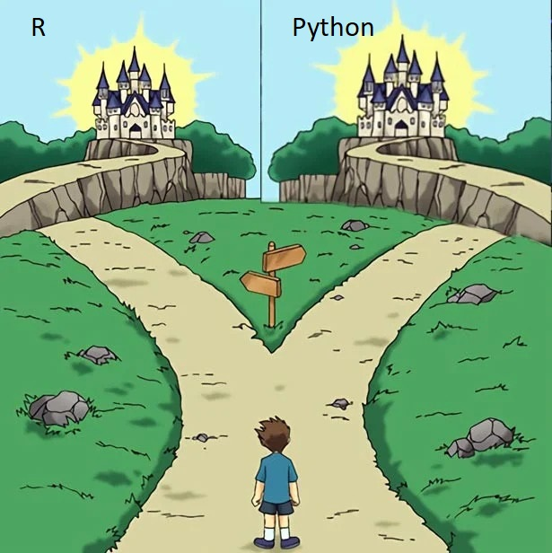

```{r}
#| label: load-packages-r
#| include: false
library(tidyverse)
library(tidyfinance)
library(nanoparquet)
library(ggridges)
library(patchwork)

# The sample of the first case study
start_date <- "2000-01-01"
end_date <- "2025-12-31"
symbols <- c("AAPL", "MSFT")

# Colours of the slides, used by the figures
ku_red <- "#901A1E"
jet <- "#3d3d3d"
grey <- "#666666"
light <- "#e6e3df"

source("lecture-slides/_live-poll.R")
background_survey <- "aef27-l01-background"
if (live) {
  ojs_define(poll_base = poll_base, background_survey = background_survey)
}
```

```{python}
#| label: load-packages-py
#| include: false
import polars as pl
import tidyfinance as tf
from plotnine import aes, facet_wrap, geom_line, ggplot, labs, theme_bw

start_date = "2000-01-01"
end_date = "2025-12-31"
symbols = ["AAPL", "MSFT"]
```

# Welcome!

## Why I teach this course

```{r}
#| label: why-i-teach-timeline
#| echo: false
#| dev: svglite
#| fig-width: 10
#| fig-height: 5.6
milestones <- tribble(
  ~step, ~title, ~text,
  1, "PhD at VGSF", "Replicating published work is far more cumbersome than it should be",
  2, "Decisions with large data", "High-frequency data: 100 billion observations, computed on HPC clusters",
  3, "Tidy Finance", "Open-source code for empirical finance, with Christoph Scheuch, my office colleague at VGSF",
  4, "Reproducibility", "How the choices of researchers change their results",
  5, "Today and next", "Machine learning and LLMs in research: what I enjoy and want to share"
) |>
  mutate(
    x = c(0.5, 6, 6, 0.5, 0.5),
    y = c(3, 3, 1.5, 1.5, 0),
    text = str_wrap(text, 30)
  )

# A half circle that turns the path down by one row, to the right (1) or left (-1)
turn <- function(x0, y_top, side) {
  angle <- seq(pi / 2, -pi / 2, length.out = 50)
  tibble(x = x0 + side * 0.75 * cos(angle), y = y_top - 0.75 + 0.75 * sin(angle))
}
snake <- bind_rows(
  tibble(x = c(-1, 11.3), y = 3),
  turn(11.3, 3, 1),
  tibble(x = c(11.3, -0.6), y = 1.5),
  turn(-0.6, 1.5, -1),
  tibble(x = c(-0.6, 11.8), y = 0)
)

ggplot() +
  geom_path(
    data = snake, aes(x, y), color = light, linewidth = 3, lineend = "round",
    arrow = arrow(length = unit(0.18, "inches"), type = "closed")
  ) +
  geom_point(data = milestones, aes(x, y), color = ku_red, size = 11) +
  geom_text(data = milestones, aes(x, y, label = step), color = "white", size = 5.5) +
  geom_text(
    data = milestones, aes(x + 0.5, y + 0.2, label = title),
    hjust = 0, vjust = 0, color = ku_red, size = 6.4
  ) +
  geom_text(
    data = milestones, aes(x + 0.5, y - 0.12, label = text),
    hjust = 0, vjust = 1, color = jet, size = 4.8, lineheight = 0.95
  ) +
  coord_cartesian(xlim = c(-1.5, 12.2), ylim = c(-0.8, 3.7), clip = "off") +
  theme_void()
```

## What AEF is about

**This course is about doing empirical finance: working with real data, from start to finish.**

:::: {.columns}
::: {.column width="50%"}
```{r}
#| label: aef-venn-diagram
#| echo: false
#| dev: svglite
#| fig-width: 6
#| fig-height: 4.6
circle <- function(x0, y0, r = 1) {
  angle <- seq(0, 2 * pi, length.out = 200)
  tibble(x = x0 + r * cos(angle), y = y0 + r * sin(angle))
}
circles <- bind_rows(
  circle(0, 0.62) |> mutate(field = "Theory"),
  circle(-0.55, -0.32) |> mutate(field = "Econometrics"),
  circle(0.55, -0.32) |> mutate(field = "Data & code")
)
fields <- tribble(
  ~field, ~x, ~y, ~question,
  "Theory", 0, 1.05, "What models predict",
  "Econometrics", -0.95, -0.68, "How to test it",
  "Data & code", 0.95, -0.68, "What we actually find"
)

ggplot() +
  geom_polygon(
    data = circles, aes(x, y, group = field),
    fill = grey, alpha = 0.1, color = "#b3b3b3", linewidth = 0.6
  ) +
  geom_text(data = fields, aes(x, y + 0.13, label = field), color = jet, size = 6.5) +
  geom_text(data = fields, aes(x, y - 0.13, label = question), color = grey, size = 5) +
  annotate(
    "segment", x = 1.75, y = 0.95, xend = 0.08, yend = 0.03, color = ku_red, linewidth = 0.8,
    arrow = arrow(length = unit(0.14, "inches"), type = "closed")
  ) +
  annotate("text", x = 1.8, y = 1.02, label = "AEF", color = ku_red, size = 8.5, hjust = 0) +
  coord_equal(xlim = c(-1.9, 2.45), ylim = c(-1.4, 1.65)) +
  theme_void()
```
:::
::: {.column width="50%"}
- Empirical finance is finance measured against reality
- Financial markets provide vast data to inform financial decisions

**(How) can state-of-the-art methods improve financial decision making?**
:::
::::

## One thread through the course

:::: {.columns}
::: {.column width="33%"}
::: {.box}
**From portfolio choice to pricing**

*February to mid-March*

The efficient portfolio and its estimation error; shrinkage and transaction costs; the SDF and the CAPM; factors, sorts and reproducibility
:::
:::
::: {.column width="33%"}
::: {.box}
**Machine learning and the SDF**

*Mid-March to April*

Overfitting and out-of-sample evaluation; shrinking the SDF; latent factors; trees, forests and neural networks on the factor zoo
:::
:::
::: {.column width="33%"}
::: {.box}
**Volatility, risk and uncertainty**

*End of April and May*

Volatility and covariances from high-frequency data; covariance forecasts for portfolio choice
:::
:::
::::

# How the course works

## Team and contact

:::: {.columns}
::: {.column width="33%"}
::: {.box}
[SV]{.initials}

**Stefan Voigt**, lecturer

[stefan.voigt@econ.ku.dk](mailto:stefan.voigt@econ.ku.dk)<br>[voigtstefan.me](https://www.voigtstefan.me)
:::
:::
::: {.column width="33%"}
::: {.box}
[NZ]{.initials}

**Nikolai Zakarias Zwisler**, teaching assistant

[xjb522@econ.ku.dk](mailto:xjb522@econ.ku.dk)
:::
:::
::: {.column width="33%"}
::: {.box}
[You]{.initials}

**You and your peers**

Teams of up to three, and the people who read your code in peer feedback: connect and help each other
:::
:::
::::

::: {.highlight}
Questions about content go to the **Absalon discussion board**, so everyone benefits from the answer
:::

## Every week

- **Lectures:** Mondays 8–10 in even weeks (CSS 1-1-18) and Thursdays 13–15 (CSS 18-01-11): methods, theory and recent papers
- **Exercises:** weekly, in R or Python, built on [Tidy Finance](https://www.tidy-finance.org); the solutions are in the book
- **Exercise classes:** Mondays 8–10 in odd weeks (CSS 2-2-36): work on the exercises and ask for help

::: {.highlight}
**Most of your time goes into the exercises.** Work through them on your own. Use AI, but make sure you know what is going on: the lectures build on your work on the exercises.
:::

The learning curve is steep: ask early, me directly, on Absalon or in the exercise classes

## Mandatory assignments

| | Topic | Date |
|---|---|---|
| 1 | Portfolio choice | 25 February – 4 March |
| 2 | Machine learning in asset pricing | 8–15 April |
| 3 | Volatility and covariances from high-frequency data | 29 April – 6 May |

- One week each; the assignments and the data come through Absalon
- Hand in one `.qmd` file and the PDF rendered from it: at most 7 pages, 12 pt, in English, from the [templates](https://github.com/advanced-empirical-finance/course-repository/tree/main/mandatory-assignments)

::: {.highlight}
**The deal:** use AI as much as you like, for code, text and review, and say how you used it. In return, you answer for every line, and we grade by a high bar: the [assignment quality criteria](https://aef-course.ku.dk/additional-material/assignment-quality-criteria.html).
:::

## Peer feedback

- Peer feedback opens **one day** after the deadline and stays open for **five** days
- Each of you gives feedback on **two** submissions of other teams
- Start by reproducing their report: does it render from their files, and do the numbers match?
- We discuss the feedback in class: you see how others solved the same problem

```{r}
#| label: peer-feedback-process
#| echo: false
#| dev: svglite
#| fig-width: 10
#| fig-height: 3.4
students <- tibble(student = paste("Student", 1:3), row = 3:1)
reports <- students |>
  cross_join(tibble(k = 1:2)) |>
  mutate(
    xmin = 8 + (k - 1) * 2.55,
    xmax = xmin + 2.35,
    label = paste("Team", LETTERS[2:7])
  )

ggplot() +
  annotate(
    "rect", xmin = 0, xmax = 7, ymin = 0.55, ymax = 3.45,
    fill = grey, alpha = 0.1, color = "#b3b3b3"
  ) +
  annotate("text", x = 3.5, y = 3.15, label = "Your team: three students, one week", color = jet, size = 5.6) +
  geom_point(data = students, aes(x = 1.2, y = row - 0.25), color = ku_red, size = 8) +
  geom_text(
    data = students, aes(x = 1.7, y = row - 0.25, label = student),
    hjust = 0, color = jet, size = 5.2
  ) +
  annotate("segment", x = 7.5, xend = 7.5, y = 0.45, yend = 3.55, color = ku_red, linewidth = 0.8) +
  annotate("text", x = 7.35, y = 0.2, label = "Deadline", color = ku_red, size = 5.4, hjust = 1) +
  annotate("text", x = 10.45, y = 3.8, label = "Each of you reviews two reports of other teams", color = jet, size = 5.4) +
  annotate("text", x = 7.7, y = 0.2, label = "Opens the next day, for five days", color = grey, size = 5.2, hjust = 0) +
  geom_rect(
    data = reports, aes(xmin = xmin, xmax = xmax, ymin = row - 0.33, ymax = row + 0.33),
    fill = "white", color = "#b3b3b3"
  ) +
  geom_text(data = reports, aes(x = (xmin + xmax) / 2, y = row, label = label), color = jet, size = 4.3) +
  annotate(
    "segment", x = 13.3, xend = 14.3, y = 2, yend = 2, color = grey, linewidth = 0.6,
    arrow = arrow(length = unit(0.12, "inches"), type = "closed")
  ) +
  annotate(
    "text", x = 14.45, y = 2, label = "Discussion\nin class",
    hjust = 0, color = jet, size = 5.4, lineheight = 0.95
  ) +
  coord_cartesian(xlim = c(0, 16), ylim = c(0.05, 4)) +
  theme_void()
```

## The trading game

<iframe data-external="1" src="https://aef-course.ku.dk/trading-game/intro/index.html" width="800" height="565" style="border: 0; display: block; margin: 0 auto;" title="The trading game in 60 seconds"></iframe>

The 60-second introduction on the homepage: [aef-course.ku.dk/trading-game](https://aef-course.ku.dk/trading-game/)

## The trading game: what matters

- The game is there to make you decide, and to discuss decisions
- Rules, tools and the dry run: [aef-course.ku.dk/trading-game](https://aef-course.ku.dk/trading-game/)

::: {.fragment}
- **Conference session** in the last lecture, on 20 May: the teams with the best out-of-sample performance present their approach, and other students discuss it, in front of faculty and quantitative traders
:::

::: {.fragment}
- **A jury** picks the best team, on investment performance **and** presentation
:::

::: {.fragment .fade-up}
[10,000 DKK]{.prize} for the winning team
:::

## How you are assessed

Continuous assessment: what you hand in and present during the semester counts

- **Three mandatory assignments**, in teams of up to three
- **Peer feedback** on the assignments of other teams, individually
- **Discussion sessions:** presentations and discussions

## Who are you?

::: {.content-visible when-profile="live"}


:::: {.columns}
::: {.column width="55%"}
```{ojs}
//| label: survey-qr-code
//| echo: false
surveyQR(background_survey)
```
:::
::: {.column width="45%"}
Seven quick questions, anonymous:

- Who are you?
- How good are you at R, Python, and AI tools for coding?
- Which tools have you used?
- Have you completed the technical prerequisites?
- What do you mainly want to take away from this course?
:::
::::
:::

::: {.content-visible unless-profile="live"}
A short anonymous survey in the first lecture:

- Who are you: master's, exchange, or PhD student?
- How good are you at R, Python, and AI tools for coding?
- Which tools have you used?
- Have you completed the technical prerequisites?
- What do you mainly want to take away from this course?
:::

::: {.content-visible when-profile="live"}
## Who are you: your answers

```{ojs}
//| label: survey-results-live
//| echo: false
background = surveyResults(background_survey)
surveyCharts(background)
```
:::

# Your setup

## R or Python?

:::: {.columns}
::: {.column width="60%"}
- Both are open source, have large communities and are standard in finance
- Pick one; every exercise and every solution exists in both
- **Tidy coding** matters more than the language: clean code in either is readable for everyone
- You give feedback on R and Python submissions: with tidy code, you understand your peers' code even in the other language
:::
::: {.column width="40%"}
{width=100% fig-align="center"}
:::
::::

## The toolbox

| Tool | What it does |
|---|---|
| **R or Python** | The language you write your analysis in |
| **Positron** | The editor: code, console, data viewer, Git and AI assistant in one place |
| **Quarto** | Weaves text and code into one report: your hand-ins are Quarto files rendered to PDF |
| **uv and uvr** | Install Python, R and exactly the course's package versions |
| **Git and GitHub** | Version control and your team's repository |

: {tbl-colwidths="[25,75]"}

# Financial data

## Where the data come from

- **CRSP** (Center for Research in Security Prices): every US common stock since 1926, from WRDS. Licensed: you get it through Absalon
- Everything lives as parquet files in the `data` folder of the course repository, as in the Tidy Finance book

| File | Content |
|---|---|
| `crsp_monthly.parquet` | CRSP monthly returns, market capitalization, exchange, industry (from Absalon) |
| `factors_ff3_monthly.parquet` | Fama-French three factors and the risk-free rate |
| `industries_ff_monthly.parquet` | Ten industry portfolios |
| `macro_predictors.parquet` | Welch and Goyal (2008) predictors |
| `cpi_monthly.parquet` | Consumer price index |

## Reading the data

::: {.panel-tabset group="language"}
## R

```{r}
#| label: read-crsp-r
crsp_monthly <- read_parquet("data/crsp_monthly.parquet")
cpi_monthly <- read_parquet("data/cpi_monthly.parquet")
```

## Python

```{python}
#| label: read-crsp-py
crsp_monthly = pl.read_parquet("data/crsp_monthly.parquet")
cpi_monthly = pl.read_parquet("data/cpi_monthly.parquet")
```
:::

- The CRSP file is licensed: never commit it, never upload it, never paste it into an AI tool. Git ignores it in the course repository
- Paths start at the repository root (`data/...`), so your code runs on your teammates' computers too

# Tidy coding: the essentials

## Tidy data and the pipe

- **Tidy data:** each variable is a column, each observation a row, each value a cell. CRSP is tidy: one row per stock and month
- **One verb per step, chained:** `|>` in R, method chaining in Python. The code reads like the analysis
- Names say what a column holds (`trading_volume_usd`, not `tmp2`); the [quality criteria](https://aef-course.ku.dk/additional-material/assignment-quality-criteria.html) have the rest

::: {.panel-tabset group="language"}
## R

```{r}
#| label: count-stocks-latest-month-r
crsp_monthly |>
  filter(date == max(date)) |>
  count(exchange)
```

## Python

```{python}
#| label: count-stocks-latest-month-py
(
    crsp_monthly.filter(pl.col("date") == pl.col("date").max())
    .group_by("exchange")
    .len()
    .sort("exchange")
)
```
:::

## A first case study: daily returns

::: {.panel-tabset group="language"}
## R

```{r}
#| label: compute-daily-returns-r
prices <- download_data(
  domain = "Stock Prices",
  symbols = symbols,
  start_date = start_date,
  end_date = end_date
)

returns <- prices |>
  arrange(symbol, date) |>
  mutate(ret = adjusted_close / lag(adjusted_close) - 1, .by = symbol) |>
  select(symbol, date, ret) |>
  drop_na(ret)
```

## Python

```{python}
#| label: compute-daily-returns-py
prices = tf.download_data(
    domain="Stock Prices",
    symbols=symbols,
    start_date=start_date,
    end_date=end_date,
)

returns = (
    prices.sort("symbol", "date")
    .with_columns(ret=pl.col("adjusted_close").pct_change().over("symbol"))
    .select("symbol", "date", "ret")
    .drop_nulls("ret")
)
```
:::

Each line is one step of the analysis: sort, compute the return of each stock, keep what you need, drop the first day

## Summaries by group

::: {.panel-tabset group="language"}
## R

```{r}
#| label: summarize-returns-r
returns |>
  summarize(
    mean = mean(ret),
    sd = sd(ret),
    min = min(ret),
    max = max(ret),
    .by = symbol
  )
```

## Python

```{python}
#| label: summarize-returns-py
returns.group_by("symbol").agg(
    mean=pl.col("ret").mean(),
    sd=pl.col("ret").std(),
    min=pl.col("ret").min(),
    max=pl.col("ret").max(),
)
```
:::

`group_by` and `summarize` (or `agg`) answer many questions in empirical finance

## The grammar of graphics

Data, a geometric shape, and aesthetics that map variables to it: `ggplot2` in R, `plotnine` in Python

::: {.panel-tabset group="language"}
## R

```{r}
#| label: plot-adjusted-prices-r
#| output-location: slide
#| fig-width: 10
#| fig-height: 5
prices |>
  ggplot(aes(x = date, y = adjusted_close)) +
  geom_line() +
  facet_wrap(~symbol, scales = "free_y") +
  labs(
    x = NULL, y = "USD",
    title = "Adjusted closing prices of Apple and Microsoft, daily"
  ) +
  theme_bw()
```

## Python

```{python}
#| label: plot-adjusted-prices-py
#| eval: false
(
    ggplot(prices, aes(x="date", y="adjusted_close"))
    + geom_line()
    + facet_wrap("symbol", scales="free_y")
    + labs(
        x="", y="USD",
        title="Adjusted closing prices of Apple and Microsoft, daily",
    )
    + theme_bw()
)
```
:::

## What the grammar of graphics can do

```{r}
#| label: market-ridgelines
#| echo: false
#| dev: svglite
#| fig-width: 10
#| fig-height: 5.4
factors_ff3_monthly <- read_parquet("data/factors_ff3_monthly.parquet") |>
  mutate(decade = paste0(floor(year(date) / 10) * 10, "s"))

sharpe_by_decade <- factors_ff3_monthly |>
  summarize(sharpe = mean(mkt_excess) / sd(mkt_excess) * sqrt(12), .by = decade)

# The two worst months and the best month of the sample
extreme_months <- bind_rows(
  factors_ff3_monthly |> slice_min(mkt_excess, n = 2),
  factors_ff3_monthly |> slice_max(mkt_excess, n = 1)
) |>
  mutate(label = paste0(format(date, "%B %Y"), ": ", scales::percent(mkt_excess, accuracy = 0.1)))

ridgelines <- ggplot(factors_ff3_monthly, aes(x = mkt_excess, y = fct_rev(decade))) +
  geom_density_ridges_gradient(
    aes(fill = after_stat(x)),
    scale = 1.6, rel_min_height = 0.005, color = "white", linewidth = 0.4
  ) +
  scale_fill_gradient2(low = ku_red, mid = light, high = jet, midpoint = 0, guide = "none") +
  geom_point(data = extreme_months, color = jet, size = 1.8) +
  ggrepel::geom_text_repel(
    data = extreme_months, aes(label = label),
    size = 4, color = jet, nudge_y = 0.6, segment.color = grey, direction = "y"
  ) +
  scale_x_continuous(labels = scales::percent) +
  labs(
    x = "Monthly excess return of the US stock market", y = NULL,
    title = "Six and a half decades of the US stock market",
    subtitle = "Distribution of monthly excess returns by decade; inset: annualized Sharpe ratio",
    caption = "Data: Kenneth R. French data library"
  ) +
  theme_minimal(base_size = 14) +
  theme(
    panel.grid.minor = element_blank(),
    panel.grid.major.y = element_blank(),
    plot.title = element_text(color = ku_red),
    plot.title.position = "plot"
  )

sharpe_bars <- ggplot(sharpe_by_decade, aes(x = decade, y = sharpe)) +
  geom_col(fill = ku_red, width = 0.6) +
  geom_text(
    aes(label = scales::number(sharpe, accuracy = 0.01), vjust = if_else(sharpe < 0, 1.4, -0.4)),
    size = 2.8, color = jet
  ) +
  geom_hline(yintercept = 0, color = grey, linewidth = 0.3) +
  scale_y_continuous(expand = expansion(mult = c(0.15, 0.25))) +
  labs(x = NULL, y = NULL) +
  theme_minimal(base_size = 9) +
  theme(
    panel.grid = element_blank(),
    axis.text.y = element_blank(),
    plot.background = element_rect(fill = "white", color = light)
  )

ridgelines + inset_element(sharpe_bars, left = 0.66, bottom = 0.01, right = 0.99, top = 0.36)
```

The same layers as on the slide before, plus two packages: ggridges and patchwork

## Where to get help

- **The homepage:** [aef-course.ku.dk](https://aef-course.ku.dk) has the lecture plan, the exercises, the trading game and the guides
- **Absalon discussion board:** questions about content and code, so everyone benefits from the answer
- **Exercise classes:** Mondays 8–10 in odd weeks (CSS 2-2-36)
- **Me directly:** [stefan.voigt@econ.ku.dk](mailto:stefan.voigt@econ.ku.dk)
