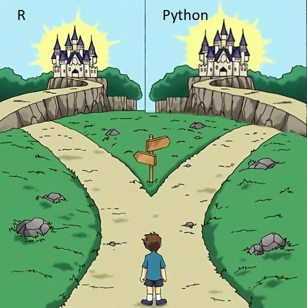

```{r}
#| label: load-packages-r
#| include: false
library(tidyverse)
library(tidyfinance)
library(nanoparquet)

# Colours of the slides, used by the figures
ku_red <- "#901A1E"
jet <- "#3d3d3d"
grey <- "#666666"
light <- "#e6e3df"

source("lecture-slides/_live-poll.R")
background_survey <- "aef27-l01-background"
if (live) {
  ojs_define(poll_base = poll_base, background_survey = background_survey)
}
```

```{python}
#| label: load-packages-py
#| include: false
import polars as pl
import tidyfinance as tf
from plotnine import aes, facet_wrap, geom_line, ggplot, labs, theme_bw
```

# Welcome!

## What AEF is about

This course is about **doing** empirical finance: working with real data, from start to finish.

```{r}
#| label: aef-venn-diagram
#| echo: false
#| dev: svglite
#| fig-width: 6
#| fig-height: 4.6
#| out-width: 62%
#| fig-align: center
circle <- function(x0, y0, r = 1) {
  angle <- seq(0, 2 * pi, length.out = 200)
  tibble(x = x0 + r * cos(angle), y = y0 + r * sin(angle))
}
circles <- bind_rows(
  circle(0, 0.62) |> mutate(field = "Theory"),
  circle(-0.55, -0.32) |> mutate(field = "Econometrics"),
  circle(0.55, -0.32) |> mutate(field = "Data & code")
)
fields <- tribble(
  ~field, ~x, ~y, ~question,
  "Theory", 0, 1.05, "What models predict",
  "Econometrics", -0.95, -0.68, "How to test it",
  "Data & code", 0.95, -0.68, "What we actually find"
)

ggplot() +
  geom_polygon(
    data = circles, aes(x, y, group = field),
    fill = grey, alpha = 0.1, color = "#b3b3b3", linewidth = 0.6
  ) +
  geom_text(data = fields, aes(x, y + 0.13, label = field), color = jet, size = 6.5) +
  geom_text(data = fields, aes(x, y - 0.13, label = question), color = grey, size = 5) +
  annotate(
    "segment", x = 1.75, y = 0.95, xend = 0.08, yend = 0.03, color = ku_red, linewidth = 0.8,
    arrow = arrow(length = unit(0.14, "inches"), type = "closed")
  ) +
  annotate("text", x = 1.8, y = 1.02, label = "AEF", color = ku_red, size = 8.5, hjust = 0) +
  coord_equal(xlim = c(-1.9, 2.45), ylim = c(-1.4, 1.65)) +
  theme_void()
```

## One thread through the course

- Empirical finance is finance measured against reality
- Financial markets provide vast data to inform financial decisions

<!-- display: flex and border-box: the three boxes end at the same height -->
:::: {.columns style="display: flex;"}
::: {.column width="33%"}
::: {.box style="box-sizing: border-box;"}
**Portfolio choice**

*February and March*

The efficient portfolio and its estimation error; shrinkage and transaction costs; the SDF and the CAPM; factors, sorts and reproducibility
:::
:::
::: {.column width="33%"}
::: {.box style="box-sizing: border-box;"}
**Machine learning**

*April*

Overfitting and out-of-sample evaluation; shrinking the SDF; latent factors; trees, forests and neural networks
:::
:::
::: {.column width="33%"}
::: {.box style="box-sizing: border-box;"}
**Volatility**

*End of April and May*

Volatility and covariances from high-frequency data; covariance forecasts for portfolio choice
:::
:::
::::

::: {.highlight}
**(How) can state-of-the-art methods improve financial decision making?**
:::

## Why I teach this course

```{r}
#| label: why-i-teach-timeline
#| echo: false
#| dev: svglite
#| fig-width: 10
#| fig-height: 5.6
milestones <- tribble(
  ~step, ~title, ~text,
  1, "PhD at VGSF", "Replicating published work is far more cumbersome than it should be",
  2, "Decisions with large data", "High-frequency data: 100 billion observations, computed on HPC clusters",
  3, "Tidy Finance", "Open-source code for empirical finance, with Christoph Scheuch, my office colleague at VGSF",
  4, "Reproducibility", "How the choices of researchers change their results",
  5, "Today and next", "Machine learning and LLMs in research: what I enjoy and want to share"
) |>
  mutate(
    x = c(0.5, 6, 6, 0.5, 0.5),
    y = c(3, 3, 1.5, 1.5, 0),
    text = str_wrap(text, 30)
  )

# A half circle that turns the path down by one row, to the right (1) or left (-1)
turn <- function(x0, y_top, side) {
  angle <- seq(pi / 2, -pi / 2, length.out = 50)
  tibble(x = x0 + side * 0.75 * cos(angle), y = y_top - 0.75 + 0.75 * sin(angle))
}
snake <- bind_rows(
  tibble(x = c(-1, 11.3), y = 3),
  turn(11.3, 3, 1),
  tibble(x = c(11.3, -0.6), y = 1.5),
  turn(-0.6, 1.5, -1),
  tibble(x = c(-0.6, 11.8), y = 0)
)

ggplot() +
  geom_path(
    data = snake, aes(x, y), color = light, linewidth = 3, lineend = "round",
    arrow = arrow(length = unit(0.18, "inches"), type = "closed")
  ) +
  geom_point(data = milestones, aes(x, y), color = ku_red, size = 11) +
  geom_text(data = milestones, aes(x, y, label = step), color = "white", size = 5.5) +
  geom_text(
    data = milestones, aes(x + 0.5, y + 0.2, label = title),
    hjust = 0, vjust = 0, color = ku_red, size = 6.4
  ) +
  geom_text(
    data = milestones, aes(x + 0.5, y - 0.12, label = text),
    hjust = 0, vjust = 1, color = jet, size = 4.8, lineheight = 0.95
  ) +
  coord_cartesian(xlim = c(-1.5, 12.2), ylim = c(-0.8, 3.7), clip = "off") +
  theme_void()
```

# How the course works

## Team and contact

<!-- display: flex and border-box: the three boxes end at the same height -->
:::: {.columns style="display: flex;"}
::: {.column width="33%"}
::: {.box style="box-sizing: border-box;"}
[SV]{.initials}

**Stefan Voigt**

[stefan.voigt@econ.ku.dk](mailto:stefan.voigt@econ.ku.dk)<br>[voigtstefan.me](https://www.voigtstefan.me)
:::
:::
::: {.column width="33%"}
::: {.box style="box-sizing: border-box;"}
[NZ]{.initials}

**Nikolai Zakarias Zwisler**, teaching assistant

[xjb522@econ.ku.dk](mailto:xjb522@econ.ku.dk)
:::
:::
::: {.column width="33%"}
::: {.box style="box-sizing: border-box;"}
[You]{.initials}

**You and your peers**

Teams of up to three, and the people who read your code in peer feedback: connect and help each other
:::
:::
::::

```{r}
#| label: alumni-network
#| echo: false
#| dev: svglite
#| fig-width: 10
#| fig-height: 2.2
# A stylized network: dots placed at random in an ellipse, each linked to its
# three nearest neighbours; neither the dots nor the links are data
set.seed(2027)
n_dots <- 400
n_links <- 3

alumni <- tibble(
  angle = runif(n_dots, 0, 2 * pi),
  radius = sqrt(runif(n_dots))
) |>
  mutate(x = 3.2 + 2.9 * radius * cos(angle), y = 1.1 * radius * sin(angle))

distances <- as.matrix(dist(select(alumni, x, y)))
diag(distances) <- Inf
links <- map(seq_len(n_dots), \(i) {
  neighbours <- order(distances[i, ])[seq_len(n_links)]
  tibble(
    x = alumni$x[i],
    y = alumni$y[i],
    xend = alumni$x[neighbours],
    yend = alumni$y[neighbours]
  )
}) |>
  list_rbind()

you <- tibble(x = -0.6, y = -0.2)
first_contact <- slice_min(alumni, x, n = 1)

ggplot() +
  geom_segment(
    data = links, aes(x, y, xend = xend, yend = yend),
    color = "#d3cfc9", linewidth = 0.3
  ) +
  geom_point(data = alumni, aes(x, y), color = grey, size = 0.9) +
  annotate(
    "segment", x = you$x, y = you$y, xend = first_contact$x, yend = first_contact$y,
    color = ku_red, linewidth = 0.6
  ) +
  geom_point(data = you, aes(x, y), color = ku_red, size = 4) +
  annotate("text", x = you$x, y = you$y - 0.38, label = "You", color = ku_red, size = 5.2) +
  annotate("text", x = 6.8, y = 0.45, label = "400+", color = ku_red, size = 13, hjust = 0) +
  annotate(
    "text", x = 6.8, y = -0.45,
    label = "alumni of AEF 2021–2026 work in the\nfinance industry in and around Copenhagen",
    color = jet, size = 5.4, hjust = 0, lineheight = 0.95
  ) +
  coord_cartesian(xlim = c(-1, 13.2), ylim = c(-1.2, 1.2), clip = "off") +
  theme_void()
```

::: {.highlight}
Questions about content go to the **Absalon discussion board**, so everyone benefits from the answer
:::

## Every week

- **Lectures:** Mondays 10–12 in odd weeks (CSS 35.3.12) and Thursdays 13–15 (CSS 18-01-11): methods, theory and recent papers. Three lectures are at other times, all 10–12: Friday 5 March (CSS 35.3.12), Wednesday 31 March and Monday 19 April (CSS 18-01-11)
- **Exercises:** in R or Python, mostly built on [Tidy Finance](https://www.tidy-finance.org), with solutions
- **Exercise classes:** Mondays 8–10 in odd weeks (CSS 2-2-36): open office hours with Nikolai

::: {.highlight}
**Most of your time goes into the exercises.** Work through them on your own. Use AI, but make sure you know what is going on: the lectures build on your work on the exercises.
:::

The learning curve is steep: ask early, on the **Absalon discussion board** (so everyone benefits from the answer), in the exercise classes or by email to [stefan.voigt@econ.ku.dk](mailto:stefan.voigt@econ.ku.dk). The lecture plan, the exercises, the trading game and the guides are on the homepage, [aef-course.ku.dk](https://aef-course.ku.dk).

## Mandatory assignments

| | Topic | Date |
|---|---|---|
| 1 | Portfolio choice | 25 February – 4 March |
| 2 | Machine learning in asset pricing | 12–19 April |
| 3 | Realized volatility from high-frequency data | 6–13 May |

- Group work, in teams of up to three students; one week each; the assignments and the data come through Absalon
- Hand in one `.qmd` file and the PDF rendered from it: at most 7 pages, 12 pt, in English, from the [templates](https://github.com/advanced-empirical-finance/course-repository/tree/main/mandatory-assignments)

::: {.highlight}
**The deal:** use AI as much as you like, for code, text and review, and say how you used it. In return, you answer for every line, and we grade by a high bar: the [assignment quality criteria](https://aef-course.ku.dk/additional-material/assignment-quality-criteria.html).
:::

## Peer feedback

- Peer feedback opens **one day** after the deadline and stays open for **seven** days
- Each of you gives feedback on **two** submissions of other teams
- Start by reproducing their report: does it render from their files, and do the numbers match?
- We discuss the feedback in class: you see how others solved the same problem

```{r}
#| label: peer-feedback-process
#| echo: false
#| dev: svglite
#| fig-width: 10
#| fig-height: 3.4
# The three students of a team sit on a circle; the axes have different
# scales, so the radius differs in x and y
team_center <- c(x = 3.5, y = 1.7)
team_radius <- c(x = 1.05, y = 0.78)

students <- tibble(angle = pi / 2 + c(0, 2, 4) * pi / 3) |>
  mutate(
    x = team_center["x"] + team_radius["x"] * cos(angle),
    y = team_center["y"] + team_radius["y"] * sin(angle)
  )
team_circle <- tibble(angle = seq(0, 2 * pi, length.out = 100)) |>
  mutate(
    x = team_center["x"] + team_radius["x"] * cos(angle),
    y = team_center["y"] + team_radius["y"] * sin(angle)
  )
reports <- tibble(row = 3:1) |>
  cross_join(tibble(k = 1:2)) |>
  mutate(
    xmin = 8 + (k - 1) * 2.55,
    xmax = xmin + 2.35,
    label = paste("Team", LETTERS[2:7])
  )

ggplot() +
  annotate(
    "rect", xmin = 0, xmax = 7, ymin = 0.55, ymax = 3.45,
    fill = grey, alpha = 0.1, color = "#b3b3b3"
  ) +
  annotate("text", x = 3.5, y = 3.12, label = "Your team: three students, one week", color = jet, size = 5.2) +
  geom_path(data = team_circle, aes(x, y), color = "#b3b3b3", linewidth = 0.6) +
  annotate(
    "text", x = team_center["x"], y = team_center["y"], label = "one\nreport",
    color = grey, size = 4.8, lineheight = 0.9
  ) +
  geom_point(data = students, aes(x, y), color = ku_red, size = 8) +
  annotate("segment", x = 7.5, xend = 7.5, y = 0.45, yend = 3.55, color = ku_red, linewidth = 0.8) +
  annotate("text", x = 7.35, y = 0.2, label = "Deadline", color = ku_red, size = 5.4, hjust = 1) +
  annotate("text", x = 10.45, y = 3.8, label = "Each of you reviews two reports of other teams", color = jet, size = 5.4) +
  annotate("text", x = 7.7, y = 0.2, label = "Opens the next day, for seven days", color = grey, size = 5.2, hjust = 0) +
  geom_rect(
    data = reports, aes(xmin = xmin, xmax = xmax, ymin = row - 0.33, ymax = row + 0.33),
    fill = "white", color = "#b3b3b3"
  ) +
  geom_text(data = reports, aes(x = (xmin + xmax) / 2, y = row, label = label), color = jet, size = 4.3) +
  annotate(
    "segment", x = 13.3, xend = 14.3, y = 2, yend = 2, color = grey, linewidth = 0.6,
    arrow = arrow(length = unit(0.12, "inches"), type = "closed")
  ) +
  annotate(
    "text", x = 14.45, y = 2, label = "Discussion\nin class",
    hjust = 0, color = jet, size = 5.4, lineheight = 0.95
  ) +
  coord_cartesian(xlim = c(0, 16), ylim = c(0.05, 4)) +
  theme_void()
```

## The trading game

<!-- The height ends below the play bar, above the credits line of the embedded page -->
<iframe data-external="1" src="https://aef-course.ku.dk/trading-game/intro/index.html" width="800" height="508" scrolling="no" style="border: 0; display: block; margin: 0 auto;" title="The trading game in 60 seconds"></iframe>

## The trading game: what matters

- The game is there to make you decide, and to discuss decisions
- Rules and tools: [aef-course.ku.dk/trading-game](https://aef-course.ku.dk/trading-game/)

::: {.fragment}
- **Conference session** in the last lecture, on 20 May: the teams with the best out-of-sample performance present their approach, and other students discuss it, in front of faculty and quantitative traders
:::

::: {.fragment}
- **A jury** picks the best team, on investment performance **and** presentation
:::

::: {.fragment .fade-up}
[10,000 DKK]{.prize} for the winning team
:::

## How you are assessed

Continuous assessment: what you hand in and present during the semester counts

- **Three mandatory assignments**, in teams of up to three
- **Peer feedback** on the assignments of other teams, individually
- **Discussion sessions:** presentations and discussions

## Who are you?

::: {.content-visible when-profile="live"}


:::: {.columns}
::: {.column width="55%"}
```{ojs}
//| label: survey-qr-code
//| echo: false
surveyQR(background_survey)
```
:::
::: {.column width="45%"}
Six quick questions, anonymous:

- Are you an exchange student?
- What do you mainly want to take away from this course?
- How good are you at R?
- How good are you at Python?
- How would you describe your use of AI?
- Have you completed the technical prerequisites?
:::
::::
:::

::: {.content-visible unless-profile="live"}
A short anonymous survey in the first lecture:

- Are you an exchange student?
- What do you mainly want to take away from this course?
- How good are you at R?
- How good are you at Python?
- How would you describe your use of AI?
- Have you completed the technical prerequisites?
:::

::: {.content-visible when-profile="live"}
## Who are you: your answers

```{ojs}
//| label: survey-results-live
//| echo: false
background = surveyResults(background_survey)
surveyCharts(background)
```
:::

# Your setup

## R or Python?

:::: {.columns}
::: {.column width="60%"}
- Both are open source, have large communities and are standard in finance
- Pick one; every exercise and every solution exists in both
- **Tidy coding** matters more than the language: clean code in either is readable for everyone
- You give feedback on R **and** Python submissions: with tidy code, you understand your peers' code even in the other language
:::
::: {.column width="40%"}
{width=100% fig-align="center"}
:::
::::

## The toolbox

| Tool | What it does |
|---|---|
| **R or Python** | The language you write your analysis in |
| **Positron** | The editor: code, console, data viewer, Git and AI assistant in one place |
| **Quarto** | Weaves text and code into one report: your hand-ins are Quarto files rendered to PDF |
| **uv and uvr** | Install Python, R and exactly the course's package versions |
| **Git and GitHub** | Version control for your team |

: {tbl-colwidths="[25,75]"}

## Where the data come from

- **CRSP** (Center for Research in Security Prices): monthly returns of every US common stock, 1960 to 2025 in the course file. Licensed: download it from Absalon into the `data` folder, as in exercise 1, together with the two VOLARE files of realized measures. Git ignores these files: never upload them, never paste them into an AI tool
- The other files are public and already in the `data` folder of the course repository

| File | Content |
|---|---|
| `crsp_monthly.parquet` | CRSP monthly returns, market capitalization, exchange, industry (Absalon) |
| `volare_realized_measures_daily.parquet` | Daily realized variances of 40 US stocks and five futures, from VOLARE (Absalon) |
| `volare_realized_covariances_daily.parquet` | Daily realized covariances of the 40 stocks (Absalon) |
| `factors_ff3_monthly.parquet` | Fama-French three factors and the risk-free rate |
| `industries_ff_monthly.parquet` | Ten industry portfolios |
| `macro_predictors.parquet` | Welch and Goyal (2008) predictors |
| `cpi_monthly.parquet` | Consumer price index |

::: {.panel-tabset group="language"}
## R

```{r}
#| label: read-crsp-r
crsp_monthly <- read_parquet("data/crsp_monthly.parquet")
cpi_monthly <- read_parquet("data/cpi_monthly.parquet")
```

## Python

```{python}
#| label: read-crsp-py
crsp_monthly = pl.read_parquet("data/crsp_monthly.parquet")
cpi_monthly = pl.read_parquet("data/cpi_monthly.parquet")
```
:::

Paths start at the repository root (`data/...`), so your code runs on your teammates' computers too

# Tidy coding: the essentials

## A first case study: daily returns

Daily prices of Apple and Microsoft, downloaded with `download_data()` from the tidyfinance package

::: {.panel-tabset group="language"}
## R

```{r}
#| label: download-stock-prices-r
symbols <- c("AAPL", "MSFT")
start_date <- "2000-01-01"
end_date <- "2025-12-31"

prices <- download_data(
  domain = "Stock Prices",
  symbols = symbols,
  start_date = start_date,
  end_date = end_date
)

head(prices, 3)
```

## Python

```{python}
#| label: download-stock-prices-py
symbols = ["AAPL", "MSFT"]
start_date = "2000-01-01"
end_date = "2025-12-31"

prices = tf.download_data(
    domain="Stock Prices",
    symbols=symbols,
    start_date=start_date,
    end_date=end_date,
)

prices.head(3)
```
:::

## Tidy data and the pipe

- **Tidy data:** each variable is a column, each observation a row, each value a cell: `prices` has one row per stock and day
- **One verb per step, chained:** `|>` in R, method chaining in Python. Each line below is one step: sort, compute the return of each stock, keep what you need, drop the first day
- Names say what a column holds (`adjusted_close`, not `tmp2`); the [quality criteria](https://aef-course.ku.dk/additional-material/assignment-quality-criteria.html) have the rest

::: {.panel-tabset group="language"}
## R

```{r}
#| label: compute-daily-returns-r
returns <- prices |>
  arrange(symbol, date) |>
  mutate(ret = adjusted_close / lag(adjusted_close) - 1, .by = symbol) |>
  select(symbol, date, ret) |>
  drop_na(ret)
```

## Python

```{python}
#| label: compute-daily-returns-py
returns = (
    prices.sort("symbol", "date")
    .with_columns(ret=pl.col("adjusted_close").pct_change().over("symbol"))
    .select("symbol", "date", "ret")
    .drop_nulls("ret")
)
```
:::

## Summaries by group

::: {.panel-tabset group="language"}
## R

```{r}
#| label: summarize-returns-r
returns |>
  summarize(
    mean = mean(ret),
    sd = sd(ret),
    min = min(ret),
    max = max(ret),
    .by = symbol
  )
```

## Python

```{python}
#| label: summarize-returns-py
returns.group_by("symbol").agg(
    mean=pl.col("ret").mean(),
    sd=pl.col("ret").std(),
    min=pl.col("ret").min(),
    max=pl.col("ret").max(),
)
```
:::

`group_by` and `summarize` (or `agg`) answer many questions in empirical finance

## The grammar of graphics

Data, a geometric shape, and aesthetics that map variables to it: `ggplot2` in R, `plotnine` in Python

::: {.panel-tabset group="language"}
## R

```{r}
#| label: plot-adjusted-prices-r
#| eval: false
prices |>
  ggplot(aes(x = date, y = adjusted_close)) +
  geom_line() +
  facet_wrap(~symbol, scales = "free_y") +
  labs(x = NULL, y = "Adjusted closing price (USD)") +
  theme_bw()
```

## Python

```{python}
#| label: plot-adjusted-prices-py
#| eval: false
(
    ggplot(prices, aes(x="date", y="adjusted_close"))
    + geom_line()
    + facet_wrap("symbol", scales="free_y")
    + labs(x="", y="Adjusted closing price (USD)")
    + theme_bw()
)
```
:::

```{r}
#| label: plot-adjusted-prices-figure
#| ref-label: plot-adjusted-prices-r
#| echo: false
#| fig-width: 10
#| fig-height: 2.9
```

## What the grammar of graphics can do

```{r}
#| label: industry-small-multiples
#| echo: false
#| dev: svglite
#| fig-width: 10
#| fig-height: 4.9
industry_names <- c(
  nodur = "Non-durable goods",
  durbl = "Durable goods",
  manuf = "Manufacturing",
  enrgy = "Energy",
  hitec = "High tech",
  telcm = "Telecom",
  shops = "Retail",
  hlth = "Health care",
  utils = "Utilities",
  other = "Other"
)

# Value of 1 USD invested in each industry portfolio in the first month
industry_values <- read_parquet("data/industries_ff_monthly.parquet") |>
  pivot_longer(-date, names_to = "industry", values_to = "ret") |>
  arrange(industry, date) |>
  mutate(value = cumprod(1 + ret), .by = industry) |>
  mutate(industry = industry_names[industry])

# Panels ordered by the final value
final_values <- industry_values |>
  slice_max(date, by = industry) |>
  arrange(desc(value)) |>
  mutate(label = paste(scales::comma(value, accuracy = 1), "USD"))
industry_order <- final_values$industry
industry_values <- industry_values |>
  mutate(industry = factor(industry, levels = industry_order))
final_values <- final_values |>
  mutate(industry = factor(industry, levels = industry_order))

ggplot(industry_values, aes(x = date, y = value)) +
  # Every panel first draws all ten industries in grey, without the facet variable
  geom_line(
    data = rename(industry_values, any_industry = industry),
    aes(group = any_industry),
    color = light, linewidth = 0.3
  ) +
  geom_line(color = ku_red, linewidth = 0.7) +
  geom_point(data = final_values, color = ku_red, size = 1.8) +
  geom_text(
    data = final_values, aes(x = min(industry_values$date), y = 3000, label = label),
    hjust = 0, vjust = 1, color = ku_red, size = 4.6
  ) +
  facet_wrap(~industry, nrow = 2) +
  scale_y_log10(
    breaks = c(1, 10, 100, 1000), labels = scales::comma,
    limits = c(0.6, 3000)
  ) +
  scale_x_date(
    breaks = as.Date(c("1980-01-01", "2000-01-01", "2020-01-01")),
    date_labels = "%Y"
  ) +
  labs(x = NULL, y = "Value of 1 USD invested\nin January 1960 (log scale)") +
  theme_minimal(base_size = 14) +
  theme(
    panel.grid.minor = element_blank(),
    panel.grid.major.x = element_blank(),
    panel.spacing.x = unit(1, "lines"),
    strip.text = element_text(hjust = 0, color = jet),
    axis.text = element_text(color = grey),
    axis.title.y = element_text(color = jet, size = 13)
  )
```

The ten Fama-French industry portfolios, January 1960 to December 2025: value-weighted returns with dividends, not adjusted for inflation. Each panel draws all industries in grey and its own in red: two line layers, a point and a label at the final value, facets and a log scale.
