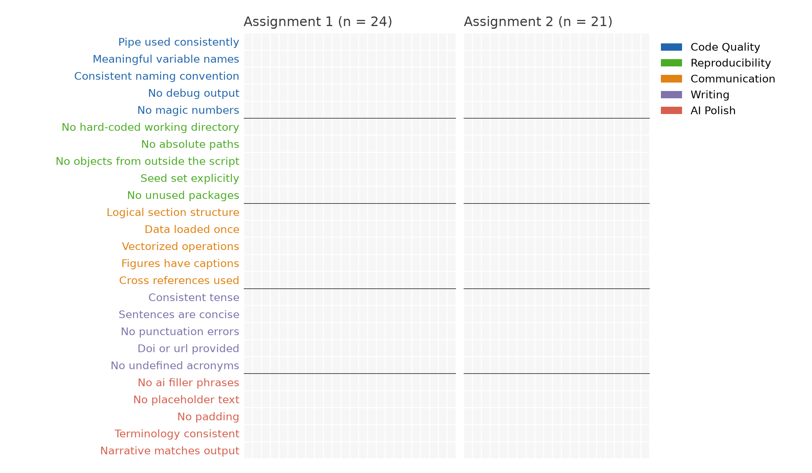
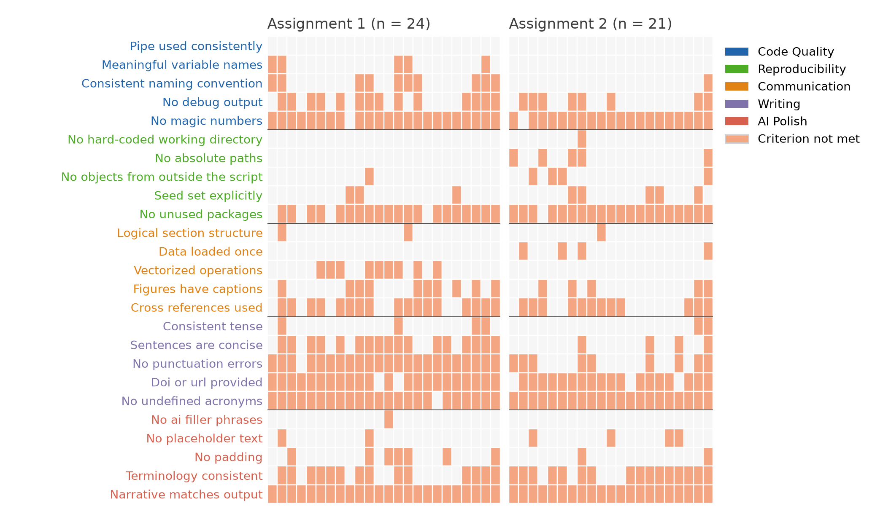
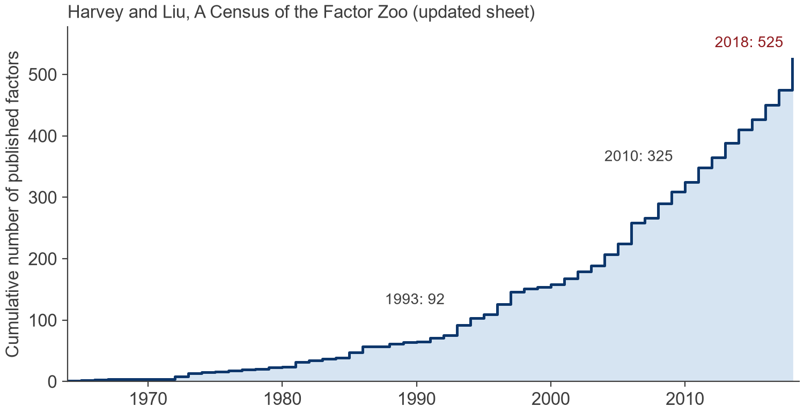

```{r}
#| label: load-packages-r
#| include: false
source("lecture-slides/_live-poll.R")
exercise_survey <- "aef27-ex05-beta-sorts"
```

## Today

- Reproducibility
- Non-standard errors: your estimates from exercise 3
- Construction choices in asset pricing

## What can go wrong doing empirical research?

:::::{.columns}

::: {.column width="38%"}
{width=78% fig-align="center"}
:::
::: {.column width="62%"}

::: {.fragment}
**Reproducible** means: someone else can regenerate every table and figure from the raw data and the code, without asking the authors

Before we ask whether a result is *right*, we ask whether someone else can *recompute* it
:::

::: {.fragment}
**This lecture.** We look at what breaks reproducibility in practice, compare your estimates from exercise 3, and see how construction choices move factor premia

**Afterwards** you can check a report for reproducibility, explain why a reproducible result still carries researchers' degrees of freedom, and name the choices inside a portfolio sort
:::

:::
::::

# Reproducibility

## Reproducibility in top finance journals

{width=60% fig-align="center"}

- **Code**: journals require it for empirical work, simulations, numerical computations and experimental studies
- **Data**: if authors cannot share the actual data, they must provide pseudo-data

## What makes reproducibility hard?

:::::{.columns}

::: {.column width="64%"}

[Your turn]{.your-turn-badge} **What can go wrong?**

- What problems can occur when running your own project?
- Do you believe your own reports are reproducible?

::: {.fragment fragment-index=1}
{width=100%}
:::

:::
::: {.column width="36%"}

::: {.fragment fragment-index=1}
**Minimum requirements**

1. Raw data and code that regenerate every table and figure
1. Software and package versions, random seeds
1. Materials openly available, not "upon request"
1. Code that a stranger (= future you) can read
:::

:::
::::

## Evidence from this course

:::: {.r-stack}
::: {.fragment .fade-out fragment-index=1}
{width=72% fig-align="center"}
:::
::: {.fragment .fade-in fragment-index=1}
{width=72% fig-align="center"}
:::
::::

- Same checks on the course's two assignments of 2026, five representative criteria per group. Unused packages and absolute paths remained the weak spots

## Your reports

- **Package versions:** `uvr.lock` (R) and `uv.lock` (Python) record every package; `uvr sync` and `uv sync` restore them on another computer
- **One command:** `uv run quarto render` in a fresh session regenerates every number, table and figure from the raw data and the code
- **Relative paths** from the repository root, such as `data/crsp_monthly.parquet`; a seed before every random step
- **Licensed data stays out:** CRSP and Compustat are read by the code but never committed; the code and the description of the data are enough to reproduce
- The [assignment quality criteria](https://aef-course.ku.dk/additional-material/assignment-quality-criteria.html) list these checks under *Reproducibility*

# Non-standard errors

## Reproducible. Are we done?

:::::{.columns}

::: {.column width="37%"}

::: {.chat theme="imessage" names="You,Albert"}
::: {.speaker-2}
Hello everybody! We are starting a large project on market efficiency. Would you join as one of the research teams?
:::

::: {.fragment .speaker-1}
Sure, sounds fun. What do you need from us?
:::

::: {.fragment .speaker-2}
::: {.attachment}
**hf-trading-data.parquet**
:::
:::

::: {.fragment .speaker-2}
Hypothesis 1: market efficiency improves over time. Please send me your t-statistic.
:::

[164 teams]{.fragment .reaction}
:::

:::
::: {.column width="63%"}

::: {.fragment}
::: {.your-turn}

[Exercise 3]{.your-turn-badge} You did the same

**1. Data.** Monthly CRSP returns and your betas from exercise 3

**2. Hypothesis.** High-beta stocks earn lower CAPM alphas than low-beta stocks

**3. Your estimate.** The CAPM alpha of high minus low, its standard error, and the choices behind it

:::

::: {.cloud-stage}

::: {.fragment .fade-up .cloud .c1}
How many portfolios?
:::
::: {.fragment .fade-up .cloud .c2}
Value or equal weights?
:::
::: {.fragment .fade-up .cloud .c3}
Which stocks?
:::
::: {.fragment .fade-up .cloud .c4}
Since when?
:::
::: {.fragment .fade-up .cloud .c5}
Which betas?
:::
::: {.fragment .fade-up .cloud .c6}
Which standard errors?
:::

:::

:::

:::
::::

## Your estimates

```{r}
#| label: survey-setup
#| include: false
if (live) {
  ojs_define(poll_base = poll_base, exercise_survey = exercise_survey)
}
```

::: {.content-visible when-profile="live"}


```{ojs}
//| label: exercise-5-estimates
//| echo: false
submissions = surveyResults(exercise_survey)
estimates = {
  if (submissions === null) return [];
  const values = id => (submissions.questions.find(q => q.id === id) || {}).values || [];
  const alpha = values("alpha"), se = values("se");
  const choice = id => i => values(id)[i] ?? "No answer";
  return alpha
    .map((a, i) => ({
      alpha: a, se: se[i], start: values("start")[i],
      portfolios: choice("portfolios")(i), weights: choice("weights")(i),
      stocks: choice("stocks")(i)
    }))
    .filter(d => d.alpha !== null && d.se !== null)
    .sort((a, b) => a.alpha - b.alpha)
    .map((d, i) => ({...d, rank: i + 1}));
}
```

```{ojs}
//| label: exercise-5-summary
//| echo: false
spread = {
  const alphas = estimates.map(d => d.alpha);
  return {
    n: estimates.length,
    median_se: d3.median(estimates, d => d.se),
    dispersion: d3.deviation(alphas),
    iqr: [d3.quantile(alphas, 0.25), d3.quantile(alphas, 0.75)]
  };
}
spread.n < 2 ? md`*Not enough estimates yet.*` : md`**${spread.n} estimates.** Median standard error: **${spread.median_se?.toFixed(1)}** percentage points. Spread across you (standard deviation): **${spread.dispersion?.toFixed(1)}** percentage points, the *non-standard error*. Half of you lie between ${spread.iqr[0]?.toFixed(1)}% and ${spread.iqr[1]?.toFixed(1)}% a year`
```

```{ojs}
//| label: exercise-5-chart
//| echo: false
Plot.plot({
  width: 1000,
  height: 400,
  x: {label: "Your estimates, sorted", ticks: [], domain: [0, estimates.length + 1]},
  y: {label: "CAPM alpha of high minus low, % a year", grid: true},
  color: {legend: true, domain: ["Value-weighted", "Equal-weighted", "Other", "No answer"],
          range: ["#901A1E", "#3d3d3d", "#b3b3b3", "#e6e3df"]},
  marks: [
    Plot.ruleY([0], {stroke: "#b3b3b3"}),
    Plot.ruleX(estimates, {x: "rank", y1: d => d.alpha - 1.96 * d.se, y2: d => d.alpha + 1.96 * d.se, stroke: "weights", strokeWidth: 2, strokeOpacity: 0.5}),
    Plot.dot(estimates, {x: "rank", y: "alpha", fill: "weights", r: 5})
  ]
})
```
:::

::: {.content-visible unless-profile="live"}
In exercise 3, you all tested the same hypothesis on the same data and made every other choice yourselves. In the lecture, we plot all your estimates with their 95% confidence intervals and compare their spread with your standard errors
:::

## Which choices matter?

::: {.content-visible when-profile="live"}
```{ojs}
//| label: exercise-5-choices
//| echo: false
choicePlot = (key, label, domain) => Plot.plot({
  width: 470,
  height: 210,
  marginLeft: 210,
  x: {label: "Alpha, % a year", grid: true},
  y: {label: null, domain: domain.filter(c => estimates.some(d => d[key] === c))},
  marks: [
    Plot.ruleX([0], {stroke: "#b3b3b3"}),
    Plot.dot(estimates, {x: "alpha", y: key, fill: "#3d3d3d", fillOpacity: 0.5, r: 4}),
    Plot.tickX(estimates, Plot.groupY({x: "mean"}, {x: "alpha", y: key, stroke: "#901A1E", strokeWidth: 3})),
    Plot.text([label], {frameAnchor: "top-left", dy: -12, fontWeight: "bold"})
  ]
})
html`<div style="display: grid; grid-template-columns: 1fr 1fr; gap: 10px 30px">
  ${choicePlot("weights", "Weights", ["Value-weighted", "Equal-weighted", "Other", "No answer"])}
  ${choicePlot("portfolios", "Number of portfolios", ["2", "3", "5", "10", "Other", "No answer"])}
  ${choicePlot("stocks", "Stocks", ["All", "Without small or penny stocks", "Other filters", "No answer"])}
  ${Plot.plot({
    width: 470,
    height: 210,
    x: {label: "First year of the sample", tickFormat: "d"},
    y: {label: "Alpha, % a year", grid: true},
    marks: [Plot.ruleY([0], {stroke: "#b3b3b3"}), Plot.dot(estimates, {x: "start", y: "alpha", fill: "#3d3d3d", fillOpacity: 0.5, r: 4})]
  })}
</div>`
```

Red ticks: the average estimate of each choice
:::

::: {.content-visible unless-profile="live"}
In the lecture: your estimates by weighting scheme, number of portfolios, the stocks you kept and the start of your sample
:::

## Non-standard errors

:::: {.r-stack}
::: {.fragment .fade-out fragment-index=1}
{width=56% fig-align="center"}
:::
::: {.fragment .fade-in fragment-index=1}
{width=56% fig-align="center"}
:::
::::

- **164 human teams, same data, same six hypotheses.** Annualized estimates: box is the interquartile range and median, whiskers the 10th to 90th percentile. The dispersion co-varies only weakly with team merits, reproducibility, or peer rating, and participants heavily underestimate it (Menkveld et al., 2024)
- **476 AI runs on the same task** concentrate on a narrow set of analysis paths: less dispersion, but systematically shifted estimates for the complex hypotheses. The choices do not disappear, they move (Huang, Menkveld, and Yu, 2026)

# Construction choices in asset pricing

## The replication crisis of finance

:::::{.columns}

::: {.column width="50%"}
{width=100%}
:::
::: {.column width="50%"}

::: {.fragment}
{width=100%}
:::

:::
::::

## P-hacking: what is odd with this figure?

{width=50% fig-align="center"}

- Reported $t$-statistics of published asset pricing factors
- Studies cluster just above the conventional significance thresholds (Harvey, 2017): the spike just above $t = 1.96$ and $t = 2.57$ is far larger than a smooth distribution would predict, and very few papers report results below them

## The factor zoo

{width=72% fig-align="center"}

- Lectures 7 and 8: a portfolio sort turns any characteristic that predicts returns into a factor. Hence the zoo
- Cochrane (2011): "Now we have a zoo of new factors"
- Do we really believe in 500+ risk factors? See [this sheet](https://docs.google.com/spreadsheets/d/1mws1bU56ZAc8aK7Dvz696LknM0Vp4Rojc3n61q2-keY/edit?gid=0#gid=0) for the census

## Is there a replication crisis in finance?

{width=80% fig-align="center"}

- Jensen, Kelly, and Pedersen (2023): most factors replicate once the evidence is pooled across many related factors
- Replication is not just about running the same code: it depends on what question you ask and how you measure the answer

## Every step of a sort is a choice

:::::{.columns}

::: {.column width="38%"}

- Lecture 7 sorted on beta: rank the stocks, set breakpoints, weight the stocks, take high minus low
- **Sample:** exclusions by market equity, industry, negative book equity or earnings, stock age or price
- **Portfolios:** lag of the sorting variable, rebalancing frequency, number of portfolios, exchanges for the breakpoints, weights

:::
::: {.column width="62%"}
{width=100%}
:::
::::

## Construction choices move alphas

:::::{.columns}

::: {.column width="52%"}
{width=100% fig-align="center"}
:::
::: {.column width="48%"}

- Voigt and Scheuch (2026) construct 176 concepts from the Open Source Asset Pricing library, each along 23,040 paths. The figure shows two of 13 themes
- Within one concept, the alphas of different paths spread over several percent per year, about as wide as the typical alpha itself. The published path is often far from the median

:::
::::

## Data preprocessing choices matter

:::::{.columns}

::: {.column width="42%"}

- Take the market and 50 published factors. Keep the idea of each factor fixed, but build it with one of 3,840 defensible sorting choices
- Draw one choice per factor, compute the out-of-sample Sharpe ratio of the best portfolio, repeat a million times

::: {.fragment}
- Same ideas, Sharpe ratios between 0.5 and 1.4. The published constructions sit at the top: only about 5% of draws do better
:::

:::
::: {.column width="58%"}
{width=100%}
:::
::::

## Teaching and research

| In this lecture | In the course | In my research |
|---|---|---|
| Reproducibility and researchers' degrees of freedom | Every assignment is a Quarto report that regenerates from raw data and code; students make and defend their own modelling decisions | Non-standard errors (Menkveld et al., 2024) |
| Construction choices in a portfolio sort | Portfolio sorts and backtests on the same CRSP and Compustat data | Which construction choices move factor premia, and by how much (Voigt and Scheuch, 2026) |
| From one factor to the whole model | Factor models and portfolio choice under estimation error | Pricing the cross-section when the construction of every factor is uncertain (Gruber, Kastner, Voigt, and Weiss, 2026) |

: {tbl-colwidths="[24,40,36]"}
