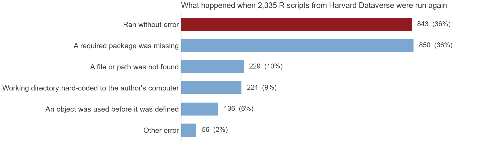
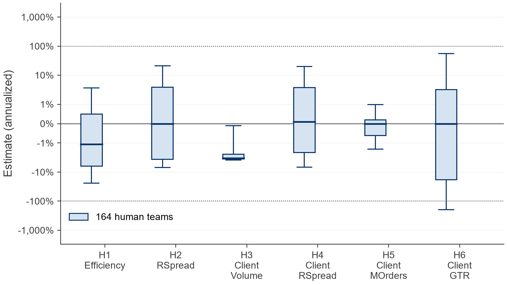
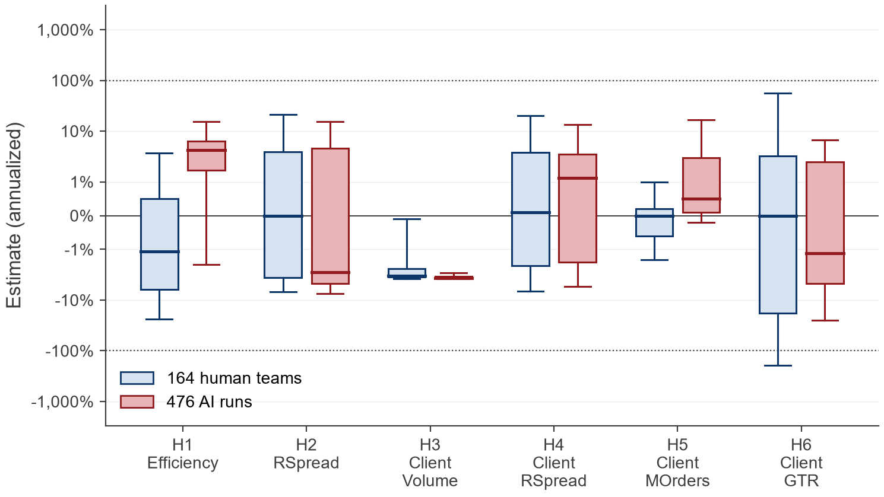
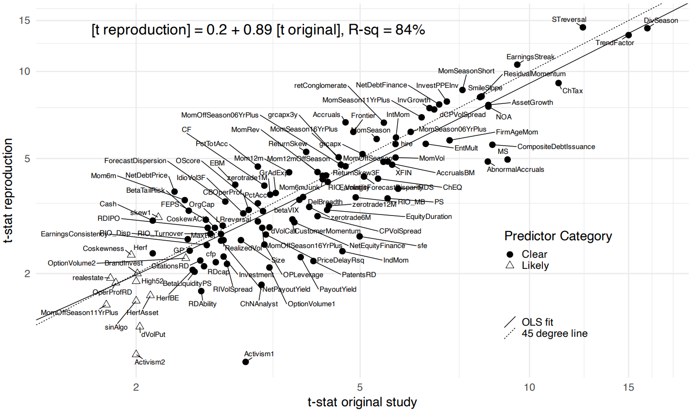
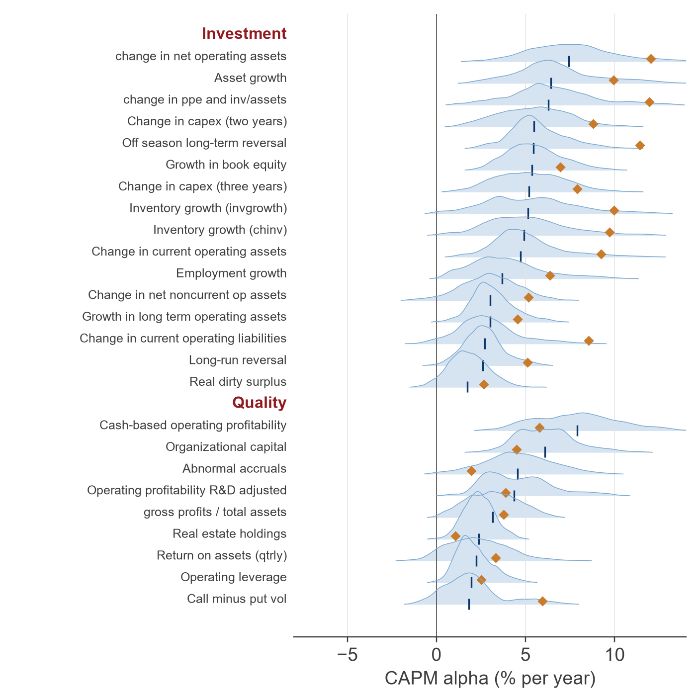
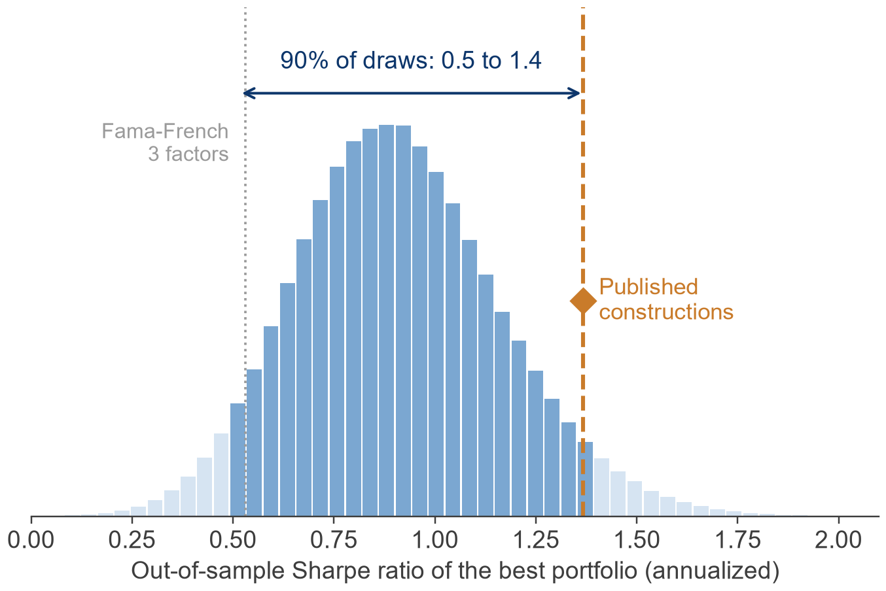

```{r}
#| label: load-packages-r
#| include: false
library(tidyverse)
library(nanoparquet)
library(scales)

source("lecture-slides/_live-poll.R")
exercise_survey <- "aef27-ex05-beta-sorts"

# Two-sided test at the 5% level: |t| above this counts as significant
critical_value <- qnorm(0.975)

# Colours of the slides, used by the figures
ku_red <- "#901A1E"
jet <- "#3d3d3d"
path_grey <- "#b3b3b3"
drawer_grey <- "#cfcac4"
theme_set(
  theme_minimal(base_size = 14) + theme(panel.grid.minor = element_blank())
)
```

## What can go wrong doing empirical research?

:::::{.columns}

::: {.column width="38%"}
{width=78% fig-align="center"}
:::
::: {.column width="62%"}

::: {.fragment}
**Reproducible** means: someone else can regenerate every table and figure from the raw data and the code, without asking the authors
:::

::: {.fragment}
::: {.highlight}
**Today:** how much can we trust a published result? One number runs through the lecture: the CAPM alpha of high minus low beta from exercise 4
:::
:::

:::
::::

# Can others recompute it?

Before we ask whether a result is *right*, we ask whether someone else can *recompute* it

## Reproducibility in top finance journals

{width=60% fig-align="center"}

- **Code**: journals require it for empirical work, simulations, numerical computations and experimental studies
- **Data**: if authors cannot share the actual data, they must provide pseudo-data

## What makes reproducibility hard?

:::::{.columns}

::: {.column width="64%"}

[Your turn]{.your-turn-badge} **What can go wrong?**

- What problems can occur when running your own project?
- Do you believe your own reports are reproducible?

::: {.fragment fragment-index=1}
{width=100%}
:::

:::
::: {.column width="36%"}

::: {.fragment fragment-index=1}
**Minimum requirements**

1. Raw data and code that regenerate every table and figure
1. Software and package versions, random seeds
1. Materials openly available, not "upon request"
1. Code that a stranger (= future you) can read
:::

:::
::::

## Your reports

- **Package versions:** `uvr.lock` (R) and `uv.lock` (Python) record every package; `uvr sync` and `uv sync` restore them on another computer
- **One command:** `uv run quarto render` in a fresh session regenerates every number, table and figure from the raw data and the code
- **Relative paths** from the repository root, such as `data/crsp_monthly.parquet`; a seed before every random step
- **Licensed data stays out:** CRSP and Compustat are read by the code but never committed; the code and the description of the data are enough to reproduce
- The [assignment quality criteria](https://aef-course.ku.dk/additional-material/assignment-quality-criteria.html) list these checks under *Reproducibility*

# Same data, same number?

Reproducible: the same code gives the same number. Would someone else's code give it, too?

## Reproducible. Are we done?

:::::{.columns}

::: {.column width="37%"}

::: {.chat theme="imessage" names="You,Albert"}
::: {.speaker-2}
Hello everybody! We are starting a large project on market efficiency. Would you join as one of the research teams?
:::

::: {.fragment .speaker-1}
Sure, sounds fun. What do you need from us?
:::

::: {.fragment .speaker-2}
::: {.attachment}
**hf-trading-data.parquet**
:::
:::

::: {.fragment .speaker-2}
Hypothesis 1: market efficiency improves over time. Please send me your t-statistic.
:::

[164 teams]{.fragment .reaction}
:::

:::
::: {.column width="63%"}

::: {.fragment}
::: {.your-turn}

[Exercise 4]{.your-turn-badge} You did the same

**1. Data.** Monthly CRSP returns and your betas from exercise 4

**2. Hypothesis.** High-beta stocks earn lower CAPM alphas than low-beta stocks

**3. Your estimate.** The CAPM alpha of high minus low, its standard error, and the choices behind it

:::

::: {.cloud-stage}

::: {.fragment .fade-up .cloud .c1}
How many portfolios?
:::
::: {.fragment .fade-up .cloud .c2}
Value or equal weights?
:::
::: {.fragment .fade-up .cloud .c3}
Which stocks?
:::
::: {.fragment .fade-up .cloud .c4}
Since when?
:::
::: {.fragment .fade-up .cloud .c5}
Which betas?
:::
::: {.fragment .fade-up .cloud .c6}
Which standard errors?
:::

:::

:::

:::
::::

## Exercise 4: your estimates

```{r}
#| label: survey-setup
#| include: false
if (live) {
  ojs_define(
    poll_base = poll_base,
    exercise_survey = exercise_survey,
    critical_value = critical_value
  )
}
```

::: {.content-visible when-profile="live"}


```{ojs}
//| label: exercise-3-estimates
//| echo: false
submissions = surveyResults(exercise_survey)
estimates = {
  if (submissions === null) return [];
  const values = id => (submissions.questions.find(q => q.id === id) || {}).values || [];
  const alpha = values("alpha"), se = values("se");
  const choice = id => i => values(id)[i] ?? "No answer";
  return alpha
    .map((a, i) => ({
      alpha: a, se: se[i], t: a / se[i], start: values("start")[i],
      portfolios: choice("portfolios")(i), weights: choice("weights")(i),
      stocks: choice("stocks")(i)
    }))
    .filter(d => d.alpha !== null && d.se !== null && d.se > 0)
    .sort((a, b) => a.alpha - b.alpha)
    .map((d, i) => ({...d, rank: i + 1}));
}
```

```{ojs}
//| label: exercise-3-summary
//| echo: false
spread = {
  const alphas = estimates.map(d => d.alpha);
  return {
    n: estimates.length,
    median_se: d3.median(estimates, d => d.se),
    dispersion: d3.deviation(alphas)
  };
}
spread.n < 2 ? md`*Not enough estimates yet.*` : md`**${spread.n} estimates**, each a dot with its 95% confidence interval. Median standard error: **${spread.median_se?.toFixed(1)}** percentage points. Spread across you (standard deviation): **${spread.dispersion?.toFixed(1)}** percentage points, the *non-standard error*`
```

```{ojs}
//| label: exercise-3-colour-by
//| echo: false
viewof colour_by = {
  const input = Inputs.radio(
    ["Weights", "Portfolios", "Stocks", "First year"],
    {value: "Weights", label: "Colour by"}
  );
  // A narrow label keeps the four options on one line
  input.style.setProperty("--label-width", "120px");
  return input;
}
```

```{ojs}
//| label: exercise-3-chart
//| echo: false
// Each choice of the survey with its colours; the first year is a number
choice_colours = ({
  "Weights": {key: "weights", domain: ["Value-weighted", "Equal-weighted", "Other", "No answer"],
              range: ["#901A1E", "#3d3d3d", "#b3b3b3", "#e6e3df"]},
  "Portfolios": {key: "portfolios", domain: ["2", "3", "5", "10", "Other", "No answer"],
                 range: ["#e3b7b9", "#c4767a", "#901A1E", "#3d3d3d", "#b3b3b3", "#e6e3df"]},
  "Stocks": {key: "stocks", domain: ["All", "Without small or penny stocks", "Other filters", "No answer"],
             range: ["#901A1E", "#3d3d3d", "#b3b3b3", "#e6e3df"]},
  "First year": {key: "start"}
})

// Plot draws legends at 10px; on a slide they need the size of the axes
function largeLegends(figure) {
  for (const legend of figure.querySelectorAll("div[class*='-swatches'], svg[class*='-ramp']")) {
    legend.style.fontSize = "15px";
    legend.style.marginBottom = "12px";
  }
  return figure;
}
{
  if (estimates.length === 0) return html`<span></span>`;
  const choice = choice_colours[colour_by];
  // The legend lists only the answers that someone gave
  const given = (choice.domain || []).map((value, i) => [value, choice.range[i]])
    .filter(([value]) => estimates.some(d => d[choice.key] === value));
  const color = choice.domain
    ? {legend: true, domain: given.map(g => g[0]), range: given.map(g => g[1])}
    : {legend: true, type: "linear", range: ["#e6e3df", "#901A1E"], label: "First year", tickFormat: "d"};
  return largeLegends(Plot.plot({
    width: 1000,
    height: 360,
    style: {fontSize: "15px"},
    x: {label: "Your estimates, sorted", ticks: [], domain: [0, estimates.length + 1]},
    y: {label: "CAPM alpha of high minus low, % a year", grid: true},
    color,
    marks: [
      Plot.ruleY([0], {stroke: "#b3b3b3"}),
      Plot.ruleX(estimates, {
        x: "rank", y1: d => d.alpha - critical_value * d.se, y2: d => d.alpha + critical_value * d.se,
        stroke: choice.key, strokeWidth: 2, strokeOpacity: 0.5
      }),
      Plot.dot(estimates, {x: "rank", y: "alpha", fill: choice.key, r: 5})
    ]
  }));
}
```
:::

::: {.content-visible unless-profile="live"}
::: {.box}
**What you did.** In exercise 4, all of you tested the same hypothesis on the same CRSP data: high-beta stocks earn lower CAPM alphas than low-beta stocks. Every other choice was yours. You entered your alpha of high minus low, its standard error and your choices in a survey
:::

**In the lecture**, a chart shows all your alphas, sorted from the lowest to the highest, each with its 95% confidence interval and coloured by one of your choices. Two numbers summarize it:

- **Median standard error:** how much one estimate is off because returns are noisy, the uncertainty that every paper reports
- **Standard deviation across you:** how much your estimates differ because of your choices, the *non-standard error*. The next slide compares both for 164 research teams
:::

## Non-standard errors

:::: {.r-stack}
::: {.fragment .fade-out fragment-index=1}
{width=56% fig-align="center"}
:::
::: {.fragment .fade-in fragment-index=1}
{width=56% fig-align="center"}
:::
::::

- **164 human teams, same data, same six hypotheses.** Annualized estimates: box is the interquartile range and median, whiskers the 10th to 90th percentile. The dispersion co-varies only weakly with team merits, reproducibility, or peer rating, and participants heavily underestimate it (Menkveld et al., 2024)
- **476 AI runs on the same task** concentrate on a narrow set of analysis paths: less dispersion, but systematically shifted estimates for the complex hypotheses. The choices do not disappear, they move (Huang, Menkveld, and Yu, 2026)

## The garden of forking paths

```{r}
#| label: forking-paths
#| include: false
# Three choices of the exercise 4 survey, without "Other": every combination
# is one path from the data to one alpha
paths <- expand_grid(
  stocks = c("All stocks", "No small stocks"),
  weights = c("Value-weighted", "Equal-weighted"),
  portfolios = c("2", "3", "5", "10")
) |>
  mutate(y = rev(row_number()))
n_paths <- nrow(paths)

# The path of one researcher, drawn in red
one_path <- c(
  stocks = "All stocks",
  weights = "Value-weighted",
  portfolios = "10"
)
```

```{r}
#| label: plot-forking-paths
#| include: false
# Each fork sits at the middle of the paths that pass through it
stock_forks <- paths |>
  summarize(y = mean(y), .by = stocks) |>
  mutate(walked = stocks == one_path[["stocks"]])
weight_forks <- paths |>
  summarize(y = mean(y), .by = c(stocks, weights)) |>
  mutate(
    walked = stocks == one_path[["stocks"]] & weights == one_path[["weights"]]
  )
leaves <- paths |>
  mutate(
    walked = stocks == one_path[["stocks"]] &
      weights == one_path[["weights"]] &
      portfolios == one_path[["portfolios"]]
  )
start_y <- mean(paths$y)

edges <- bind_rows(
  stock_forks |> transmute(x = 0, y0 = start_y, xend = 1, yend = y, walked),
  weight_forks |>
    left_join(stock_forks |> select(stocks, y0 = y), by = "stocks") |>
    transmute(x = 1, y0, xend = 2, yend = y, walked),
  leaves |>
    left_join(
      weight_forks |> select(stocks, weights, y0 = y),
      by = c("stocks", "weights")
    ) |>
    transmute(x = 2, y0, xend = 3, yend = y, walked)
)
nodes <- bind_rows(
  stock_forks |> transmute(x = 1, y, label = stocks, walked),
  weight_forks |> transmute(x = 2, y, label = weights, walked),
  leaves |> transmute(x = 3, y, label = portfolios, walked)
)
headers <- tibble(
  x = c(0, 1, 2, 3),
  label = c("Data", "Stocks", "Weights", "Portfolios")
)

forking_plot <- ggplot() +
  geom_segment(
    data = arrange(edges, walked),
    aes(
      x = x,
      y = y0,
      xend = xend,
      yend = yend,
      color = walked,
      linewidth = walked
    ),
    lineend = "round"
  ) +
  geom_point(
    data = arrange(nodes, walked),
    aes(x = x, y = y, color = walked),
    size = 2.2
  ) +
  geom_point(aes(x = 0, y = start_y), color = jet, size = 3) +
  geom_label(
    data = filter(nodes, x < 3),
    aes(x = x, y = y, label = label, color = walked),
    size = 4,
    linewidth = 0,
    fill = "white",
    nudge_y = 0.8
  ) +
  geom_text(
    data = filter(nodes, x == 3),
    aes(x = x, y = y, label = label, color = walked),
    size = 4,
    hjust = 0,
    nudge_x = 0.08
  ) +
  annotate(
    "text",
    x = 3.35,
    y = filter(leaves, walked)$y,
    label = "one alpha",
    hjust = 0,
    size = 4,
    color = ku_red
  ) +
  geom_text(
    data = headers,
    aes(x = x, y = n_paths + 1.6, label = label),
    size = 4.4,
    fontface = "bold",
    color = jet
  ) +
  scale_color_manual(
    values = c(`TRUE` = ku_red, `FALSE` = path_grey),
    guide = "none"
  ) +
  scale_linewidth_manual(
    values = c(`TRUE` = 1.3, `FALSE` = 0.5),
    guide = "none"
  ) +
  scale_x_continuous(limits = c(-0.25, 3.9)) +
  scale_y_continuous(limits = c(0.5, n_paths + 2)) +
  theme_void()
```

:::::{.columns}

::: {.column width="42%"}

- **Gelman and Loken (2013):** every reasonable choice is a fork in the path from the data to the result. Each researcher walks one path and reports one number
- **No cheating needed:** a researcher who tries only one path still reports a number that depends on the path
- **Exercise 4:** three of your choices alone give `r n_paths` paths; the betas, the sample period and the standard errors multiply them

:::
::: {.column width="58%"}

```{r}
#| label: show-forking-paths
#| echo: false
#| fig-width: 6.4
#| fig-height: 5
forking_plot
```

:::
::::

# What gets published?

Every path gives a number, but readers mostly see the significant ones

## If only significant alphas were published

```{r}
#| label: simulate-publication
#| include: false
# Many researchers estimate the same alpha; noise moves each estimate. The
# standard error is about that of the high minus low alpha in lecture 7
n_researchers <- 1000
true_alpha <- -2
standard_error <- 2.7

set.seed(2027)
researchers <- tibble(
  alpha = rnorm(n_researchers, mean = true_alpha, sd = standard_error),
  t = alpha / standard_error,
  published = abs(t) > critical_value
)
published <- filter(researchers, published)
n_published <- nrow(published)
average_published <- mean(published$alpha)
```

```{r}
#| label: plot-publication
#| include: false
# The t-statistic without its sign, as the literature reports it. Bars end
# exactly at 1.96, so that no bar mixes the two groups
bin_width <- critical_value / 4
publication_plot <- researchers |>
  mutate(
    status = if_else(published, "Published", "In the file drawer"),
    status = factor(status, levels = c("In the file drawer", "Published"))
  ) |>
  ggplot(aes(x = abs(t), fill = status)) +
  geom_histogram(
    binwidth = bin_width,
    boundary = 0,
    color = "white",
    linewidth = 0.2
  ) +
  geom_vline(xintercept = critical_value, linetype = "dashed", color = jet) +
  annotate(
    "text",
    x = critical_value,
    y = Inf,
    vjust = 1.4,
    hjust = -0.08,
    size = 4.5,
    color = jet,
    label = paste("|t| =", number(critical_value, 0.01))
  ) +
  scale_fill_manual(
    values = c("In the file drawer" = drawer_grey, "Published" = ku_red)
  ) +
  scale_x_continuous(breaks = 0:5) +
  scale_y_continuous(expand = expansion(mult = c(0, 0.08))) +
  labs(
    x = "t-statistic of the alpha, without its sign",
    y = "Researchers",
    fill = NULL,
    subtitle = paste0(
      "Simulation: ",
      comma(n_researchers),
      " researchers, true alpha ",
      number(true_alpha, 1, style_negative = "minus"),
      "% a year"
    )
  ) +
  theme(
    legend.position = "top",
    legend.justification = "left",
    panel.grid.major.x = element_blank()
  )
```

::: {.content-visible when-profile="live"}
Your exercise 4 estimates as t-statistics, alpha divided by its standard error. A journal that publishes only [|*t*| > `r number(critical_value, 0.01)`]{style="white-space: nowrap"} prints only the red ones

```{ojs}
//| label: exercise-3-publication
//| echo: false
{
  if (estimates.length < 2) return md`*Not enough estimates yet.*`;
  // The t-statistic without its sign, as the literature reports it. Bars end
  // exactly at 1.96, so that no bar mixes the two groups
  const width = critical_value / 4;
  const last = Math.max(11, Math.ceil(d3.max(estimates, d => Math.abs(d.t)) / width));
  const thresholds = d3.range(0, last + 1).map(k => k * width);
  const status = d => Math.abs(d.t) > critical_value ? "Published" : "In the file drawer";
  return largeLegends(Plot.plot({
    width: 1000,
    height: 380,
    marginTop: 30,
    marginBottom: 50,
    style: {fontSize: "15px"},
    x: {label: "t-statistic of your alpha, without its sign", labelAnchor: "center", labelOffset: 44,
        domain: [0, thresholds[thresholds.length - 1]]},
    y: {label: "Estimates", grid: true, tickFormat: "d"},
    color: {legend: true, domain: ["In the file drawer", "Published"], range: ["#cfcac4", "#901A1E"]},
    marks: [
      Plot.rectY(estimates, Plot.binX({y: "count"}, {x: d => Math.abs(d.t), fill: status, thresholds, inset: 0.5})),
      Plot.ruleX([critical_value], {stroke: "#3d3d3d", strokeDasharray: "5,4"}),
      Plot.ruleY([0])
    ]
  }));
}
```

```{ojs}
//| label: exercise-3-publication-summary
//| echo: false
{
  const published = estimates.filter(d => Math.abs(d.t) > critical_value);
  const average = rows => rows.length ? d3.format(".1f")(d3.mean(rows, d => d.alpha)) + "%" : "–";
  return estimates.length < 2 ? md`` : md`**All ${estimates.length} estimates:** average alpha ${average(estimates)} a year. **"Published" ${published.length}:** average alpha ${average(published)} a year`;
}
```
:::

::: {.content-visible unless-profile="live"}
:::::{.columns}

::: {.column width="40%"}

- **Simulation:** `r comma(n_researchers)` researchers estimate the same alpha. True alpha: `r number(true_alpha, 1, style_negative = "minus")`% a year; standard error of each estimate: `r standard_error`% a year
- **The journal** publishes only $|t| > `r number(critical_value, 0.01)`$
- **Published:** `r n_published` of `r comma(n_researchers)`, with an average alpha of `r number(average_published, 0.1, style_negative = "minus")`% a year, `r number(average_published / true_alpha, 0.1)` times the true alpha
- **In the lecture:** the same filter on your exercise 4 estimates

:::
::: {.column width="60%"}

```{r}
#| label: show-publication
#| echo: false
#| fig-width: 6.6
#| fig-height: 5.2
publication_plot
```

:::
::::
:::

## P-hacking: what is odd with this figure?

{width=43% fig-align="center"}

- Reported $t$-statistics of published factors, 1963 to 2012 (Harvey, Liu, and Zhu, 2016): few below 2, many just above. The cliff of our "published" histogram
- Two filters produce it: journals publish mostly significant results, and researchers try further paths until $t$ clears the bar (Harvey, 2017)

## The factor zoo

<!-- The crop hides the title inside the PNG, which repeated the slide title -->
)](figures/factor-zoo-cumulative.png){width=72% fig-align="center" style="aspect-ratio: 1499 / 728; object-fit: cover; object-position: bottom"}

- Lectures 7 and 8: a portfolio sort turns any characteristic that predicts returns into a factor
- Many researchers × many paths × publish if $|t| > `r number(critical_value, 0.01)`$: do we really believe in 500+ risk factors? Cochrane (2011): "Now we have a zoo of new factors"

# Does it hold up?

If many published factors are luck, they should fail when someone tries again

## The replication crisis of finance

:::::{.columns}

::: {.column width="50%"}
{width=100%}
:::
::: {.column width="50%"}

::: {.fragment}
{width=100%}
:::

:::
::::

## Is there a replication crisis in finance?

{width=80% fig-align="center"}

- Hou, Xue, and Zhang (2020): 35% of the anomalies replicate. Jensen, Kelly, and Pedersen (2023): 82.4%, with their sample, CAPM alphas, and a Bayesian model that pools related factors
- Each bar changes one choice: the sample, the method, which factors count, raw returns or alphas, the correction for multiple testing. Whether the literature replicates has a non-standard error of its own

# Measuring the choices

If the answer depends on the choices, build each factor along every reasonable path

## Every step of a sort is a choice

:::::{.columns}

::: {.column width="38%"}

- Lecture 7 sorted on beta: rank the stocks, set breakpoints, weight the stocks, take high minus low
- **Sample:** exclusions by market equity, industry, negative book equity or earnings, stock age or price
- **Portfolios:** lag of the sorting variable, rebalancing frequency, number of portfolios, exchanges for the breakpoints, weights

:::
::: {.column width="62%"}
{width=100%}
:::
::::

## Construction choices move alphas

:::::{.columns}

::: {.column width="52%"}
{width=100% fig-align="center"}
:::
::: {.column width="48%"}

- Voigt and Scheuch (2026) construct 176 concepts from the Open Source Asset Pricing library, each along 23,040 paths. The figure shows two of 13 themes
- Within one concept, the alphas of different paths spread over several percent per year, about as wide as the typical alpha itself. The published path is often far from the median

:::
::::

## Data preprocessing choices matter

:::::{.columns}

::: {.column width="42%"}

- Take the market and 50 published factors. Keep the idea of each factor fixed, but build it with one of 3,840 defensible sorting choices
- Draw one choice per factor, compute the out-of-sample Sharpe ratio of the best portfolio, repeat a million times

::: {.fragment}
- Same ideas, Sharpe ratios between 0.5 and 1.4. The published constructions sit at the top: only about 5% of draws do better
:::

:::
::: {.column width="58%"}
{width=100%}
:::
::::

## What we do about it

```{r}
#| label: count-anomalies
#| include: false
# The factor zoo of lecture 10: Open Source Asset Pricing anomalies with a
# return in every month of its sample, split into estimation and test years
zoo_start <- ymd("1973-01-01")
zoo_end <- ymd("2023-12-31")
zoo_test_start <- ymd("2000-01-01")
n_anomalies <- read_parquet("data/osap_long_short_returns.parquet") |>
  mutate(date = floor_date(as.Date(date), "month")) |>
  filter(between(date, zoo_start, zoo_end)) |>
  select(-date) |>
  select(where(\(x) !anyNA(x))) |>
  ncol()
```

- **Report every choice**, and show how the number moves along the other reasonable paths, not only along the one that worked
- **Raise the bar:** a new factor needs $t > 3$ rather than `r number(critical_value, 0.01)`, because hundreds of factors have been tried before (Harvey, Liu, and Zhu, 2016)
- **Test out of sample:** a factor found in the data until `r year(zoo_test_start) - 1` must also work from `r year(zoo_test_start)`. Lecture 10 runs this test on the factor zoo: `r n_anomalies` anomalies

::: {.highlight}
**Your reports:** state every choice, check that the result survives the other reasonable ones, and keep a test sample that no decision has seen
:::
