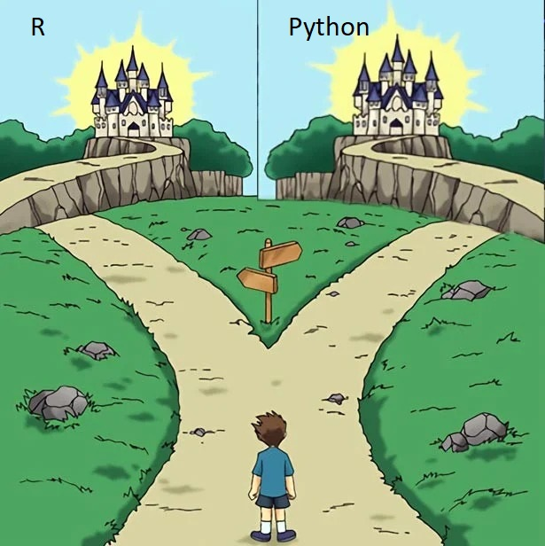
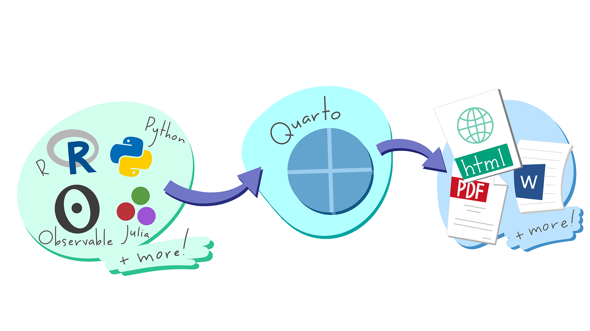
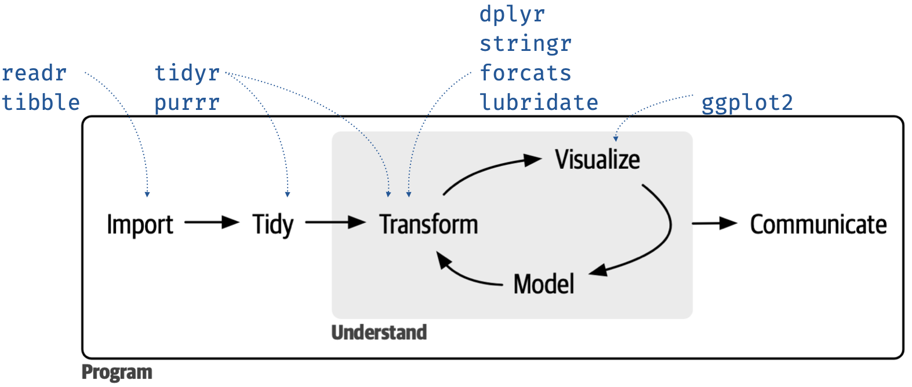
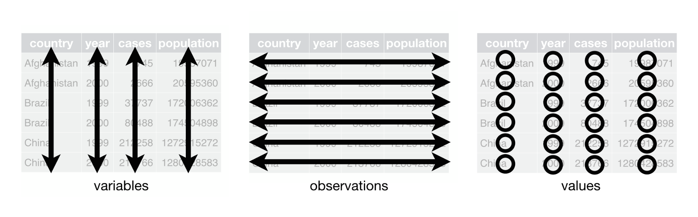

# Welcome!

## Kicking off Advanced Empirical Finance (AEF)

- What is this course about?
- How do we organize this course?
- Set up R, Python, Quarto, and Positron
- Tidy coding principles

## What is empirical finance? Data science?

**(How) can state-of-the-art methods improve financial decision making?**

Empirical finance is finance measured against reality

- Financial markets provide vast data to inform financial decisions
- Can we predict investment risks? What determines asset prices?

Data Science buzzwords: big data, machine learning, AI

- The less intriguing reality: How to extract knowledge from typically very large or unstructured data?
- We incorporate skills from computer science, statistics, and information visualization and project them on economics theory

## Topics of this course

- Optimal portfolio allocation
- Backtesting of portfolio strategies
- Risk premia and factor selection
- Machine learning toolbox for financial forecasting
- Risk management and volatility estimation

At the end of the course, you should

- Understand the current state of research in empirical asset pricing
- Recognize the value of reproducible research (and know how to conduct a reproducible analysis)
- Have your own ready-to-use state-of-the-art toolbox for empirical analysis

## Objectives and tasks

Guided coding assignments

- Plan, perform, and implement data-science applications from scratch
- Master and carry through relevant asset pricing models and solutions in new, unpredictable, and complex contexts
- In plain words: *Learn how to use R or Python for empirical projects by conducting your own research!*

The lecture builds on very recent academic papers

- We discuss and criticize multifactor asset pricing, portfolio choice, and machine learning in asset pricing
- The reading list is available on the [course homepage](https://aef-course.ku.dk/slides-index.html)
- Be prepared to discuss the literature during the lecture

## This course within the KU curriculum

AEF closes the gap between core finance courses at KU

- Financial Decision Making
- Financial Econometrics A

Related courses to consider

- Introduction to Programming and Numerical Analysis
- Various seminars in (applied) finance
- Master thesis in our finance track (empirical finance? [Check my homepage](https://www.voigtstefan.me/blog/blog-thesis-supervision.html) and get in touch *early*)

# Administration

## Team and communication

- Stefan ([stefan.voigt@econ.ku.dk](mailto:stefan.voigt@econ.ku.dk), [www.voigtstefan.me](https://www.voigtstefan.me))
- Weekly office hours - a chance to ask questions (Thursdays, 11.00 - 12.00)
- Show up to my office or online: [669 9264 2905 (password: 687063)](https://ucph-ku.zoom.us/j/66992642905?pwd=TjViN1VURXlUaUo1SEN5RndOQ1VOUT09)
- Teaching assistants: Jacob ([jacob.wiberg.larsen@econ.ku.dk](mailto:jacob.wiberg.larsen@econ.ku.dk)) and Gabriel ([lmk109@econ.ku.dk](mailto:lmk109@econ.ku.dk))
- Jacob and Gabriel moderate Absalon discussions and exercise classes, but it is *your* responsibility to actively engage in the exchange of ideas, code, and knowledge
- We provide all exercises, slides, data, and other documents via Github / Absalon
- **Rest of the team**: all the peers around you - connect and help each other out!

- Lectures: CSS 25-01-53. Exercise classes: CSS 4-1-30
- I record all lectures (no guarantee that things always work, and the ultimate priority is the crowd on campus)

## This is how the course works


You can do tech without statistics but you cannot do it without coding

- Lectures on Monday (even weeks) and every Thursday ([see timetable](https://kurser.ku.dk/course/a%C3%98kk08407u/)): state-of-the-art methods and theory
- Lecture plan contains weekly coding assignments
- I provide detailed solutions - but I *strongly recommend* that you solve everything on your own
- If you alert me in due time, I will address some exercises or discuss the solutions
- The exercise classes are in the style of open office-hours. The TAs are there to help you - but it is your responsibility to ask in advance if you have questions

The learning curve is very steep, remember to reach out in case something is unclear

## Mandatory Assignments

- 7-day long coding assignments in which we transfer the theory into practice
- You can write the assignments individually or in **groups of a maximum of three students** (you can sign up on the Absalon discussion board if you search for group members)
- You should hand in one (!) .qmd (Quarto) script with commented source code and one (!) .pdf report in which you describe your methods and results (e.g., with figures, tables, equations, etc.)
- **Handed-in report: max. 7 pages for .pdf file in total** (font size 12pt, use [these (click here)](https://github.com/advanced-empirical-finance/course-repository/tree/main/mandatory-assignments) templates)
- Answer all parts in English

## Mark the dates: Mandatory Assignments

1. mandatory assignment starts **March 1st**
2. mandatory assignment starts **April 12th**
3. mandatory assignment starts **May 3rd**

- We will always upload the assignments (and data, where needed) on Absalon
- Deadline: One week to work on your solutions
- **Minimum requirement to get feedback:** Attempt to solve every task. Document your struggles if you do not finish an exercise. The code needs to run without any error or interruption so that your peers can focus on the content instead of fixing your bugs

## Peer feedback

- Peer feedback opens two days after the submission
- Everybody provides feedback for **two** peer assignments individually (this is *one of the most critical steps towards success* - reserve time to give helpful feedback and learn from the answers of your peers)
- The peer feedback period is open for seven days
- If you receive feedback that you feel the reviewer should have drafted more carefully, flag it. I will be very strict in discarding useless submissions and comments

##	Final Exam

- To qualify for the exam, you have to hand in a minimum of two out of the three mandatory assignments *and* provide useful written peer feedback for a minimum of *two* out of the three mandatory assignments to *two* other assignments
- Portfolio exam: **48 hours from June 24 to June 26**
- The exam is a written assignment and consists of two parts: one selected mandatory assignment and a set of entirely new exercises
- You will hand in a .pdf report and a .qmd file that replicates all results in your report

# Where do we start?

## Why did you choose to enroll in this course?

{width=25% fig-align="center"}

[https://padlet.com/stefanvoigt2/8xyqpu91evwvndss](https://padlet.com/stefanvoigt2/8xyqpu91evwvndss){style="color:#901A1E;"}

1. Bachelor's/Master's/Exchange student?
2. Coding experience (General, R, Python, tidyverse)?
3. General interest in finance? Data science? Skills for your future career?

# Set up R, Python, Quarto, and Positron

## Language-agnostic coding


:::: {.columns}
::: {.column width="60%"}
-	Focus on **tidy coding**, not just language proficiency
- You can write clean, reproducible code in Python *and* R
- Follow standard ground rules and irrespective of your preferences, code will be readable, understandable, and intuitive 

- You will give feedback on Python and R submissions - stick to tidy coding principles, and you will be able to understand what the code of your peers is doing even if you are not an expert in their chosen language
- Reversely, that means: Take tidy coding seriously to maximize your chance for valuable feedback
:::
::: {.column width="40%"}
{width=100% fig-align="center"}
:::
::::

## Select your coding language

Stick to R, Python (or Julia) because:

- **Open source**: to avoid license issues (or work with computing clusters)
- **Active community**: to benefit  from robust support & shared knowledge
- **Industry standards**: to align with well-established tools (in finance)
- **Versatility**: reproducibility, high-quality visualization & flexible data handling
- Typically **less critical** in academia: **execution speed** in interactive sessions


## What is Quarto?

- R and Python are languages and environments for statistical computing
- With Quarto you can embed code directly into the analysis. It is easy to share your reproducible R and Python output using Quarto

{width=40% fig-align="center"}


## Why Positron? Setup for this course

- While *R* and *Python* run computations, *Positron* is an integrated development environment (IDE) that provides an interface by adding many convenient features and tools
- Strongly recommend using Positron as an interface, but you can use other editors
- Advanced embedding of version control (Github) and AI tools
- You can use either Python or R and process your code with Quarto (there will be an asynchronous lecture on how to use Quarto)
- We will all work in the same environment to ensure your peers can reproduce your results

## Data science workflow: tidyverse and polars

{width=60% fig-align="center"}

- In R we work almost exclusively with tidyverse packages: ggplot, dplyr, readr, ...
- The tidyverse is "a framework [...] that aims at doing the cleaning and preparing steps much easier"
- [Wickham's and Grolemund's book *R for Data Science*](https://r4ds.hadley.nz/) explains everything we need
- During this semester, we cover almost every topic from their book
- Python library equivalents: `polars`, `numpy`, `plotnine`

## Ready for a first case study?

- Start by opening your Positron project

::: {.panel-tabset  group="language"}
## R 

- load the packages `tidyverse` and `tidyfinance`
- Import data: `read_csv()`, `read_txt()`, .., or download with `tidyfinance`
```{r}
library(tidyverse)
library(tidyfinance)

prices <- download_data(
  "Stock Prices",
  symbols = c("AAPL", "MSFT"),
  start_date = "2000-01-01",
  end_date = "2026-02-01"
)
```

## Python

- load the libraries `polars`, `numpy`, and `tidyfinance`
- Import data: `pl.read_csv()`, `pl.read_parquet()`, .., or download with `tidyfinance`
```{python}
import polars as pl
import numpy as np
import tidyfinance as tf

prices = tf.download_data(
  domain="Stock Prices", 
  symbols=["AAPL", "MSFT"],
  start_date="2000-01-01", 
  end_date="2026-02-01"
)
```

::: 

## Give your code some air with `|>` and `.`

- We replace `verb(subject, complement)` with `subject |> verb(complement)` (R) or `subject.verb(complement)` (Python)
- No need to name unimportant variables
- Clear readability

:::{.panel-tabset  group="language"}

## R

```{r}
prices <- prices |>
  rename(traded_shares = volume) |>
  mutate(volume_usd = traded_shares * close / 1000000) # Volume in million USD
```

- Do not get confused. Some teaching resources (and LLMs) use (outdated) `%>%` instead of `|>` in R!

## Python

```{python}
prices = (prices
  .rename({"volume": "traded_shares"})
  .with_columns(volume_usd=pl.col("traded_shares") * pl.col("close") / 1000000)
)
```
::: 

## Next steps

:::{.panel-tabset  group="language"}

## R 
- Select or drop columns
```{r}
#| eval: false
prices |> select(symbol, date, adjusted_close) 
prices |> select(-close) 
```

- Working with `date` format
```{r}
#| eval: false
prices <- prices |> mutate(year = year(date))
```

## Python
- Select or drop columns
```{python}
#| eval: false

prices.select("symbol", "date", "adjusted_close")
prices.drop("close")
```

- Working with `date` format
```{python}
#| eval: false

prices = prices.with_columns(year=pl.col("date").dt.year())
```
:::

## Basic exploratory data analysis

:::{.panel-tabset  group="language"}

## R

- `count`, `group_by` and `summarise` solve *many* data science questions
- *How many daily observations per symbol?*
```{r}
prices |> count(symbol)
```

- *Which ticker had the highest average daily volume (in USD)?*

```{r}
prices |>
  group_by(symbol) |>
  summarise(avg_volume = mean(volume_usd))
```

## Python

- `len`, `group_by` and `agg` solve *many* data science questions
- *How many daily observations per symbol?*
```{python}
prices.group_by("symbol").len().sort("symbol")
```

- *Which ticker had the highest average daily volume (in USD)?*

```{python}
(prices
  .group_by("symbol")
  .agg(avg_volume=pl.col("volume_usd").mean())
  .sort("symbol")
)
```

::: 

## Tidy data: "grammar" of data science workflows

{width=40% fig-align="center"}

- Clear data structure to ensure similar workflows for everyday tasks
- Tidy data is a standard way of mapping the meaning of a dataset to its structure
- Each variable forms a column. Each observation forms a row. Each cell is a single measurement

## Language-agnostic tidy coding principles

::::{.columns}
:::{.column width="45%"}
```{r}
# R
returns <- prices |>
  filter(symbol == "AAPL") |>
  arrange(date) |>
  mutate(ret = adjusted_close / lag(adjusted_close) - 1) |>
  select(symbol, date, ret) |>
  drop_na(ret)
returns
```
:::
:::{.column width="45%"}
```{python}
# Python
returns = (prices
  .filter(pl.col("symbol") == "AAPL")
  .sort("date")
  .with_columns(ret=pl.col("adjusted_close").pct_change())
  .select("symbol", "date", "ret")
  .drop_nulls("ret"))
returns.head(10)
```
:::
::::

## Tidy coding principles in a nutshell

- Great code is very subjective but the aim should be to make it human-readable
- In this course I want you to think and reflect about *what* makes code useful?

**Core principles to make code readable**

1. chaining ( `|>` or `.`)
1. intuitive naming conventions (`trading_volume_usd` instead of `tmp_Var_2`)
1. Tidy data principles with a clear data structure
1. Embed code directly into the analysis with `Quarto`

## The grammar of graphics

- `ggplot2`: *G*rammar of *g*raphics differentiates between the data and the representation: i) Data (data frame we plot), ii) Geometrics (geometric shape that represents the data, e.g. point, boxplot, histogram), iii) Aesthetics (color, size, shape)
- Virtually unlimited possibilities, see [Cedric Scherer's blog](https://cedricscherer.netlify.app/top/dataviz/)

:::{.panel-tabset  group="language"}

## R 
```{r}
#| output-location: slide
library(scales)
prices |> 
  ggplot(aes(x = date, y = volume_usd, color = symbol)) +
  geom_point(size = 0.2) + geom_line(linetype = "dotted") + 
  labs(x = "Year", y ="Volume (USD)", title = "Daily trading volume", color = NULL) +
  facet_wrap(~symbol, scales = "free_x") + theme_bw() +
  scale_y_continuous(labels = scales::unit_format(unit = "M", 
                                                  prefix = "$")) +
                                                  theme(legend.position = "none")
```

- Many more themes here: https://ggplot2.tidyverse.org/reference/ggtheme.html

## Python
```{python}
#| eval: false
from plotnine import *
from mizani.formatters import label_dollar
price_plot = (
    ggplot(prices, aes(x="date", y="volume_usd", color="symbol"))
    + geom_point(size=0.2)
    + geom_line(linetype="dotted")
    + labs(
        x="Year",
        y="Volume (USD)",
        title="Daily volume",
        color=None
    )
    + facet_wrap("~symbol", scales="free_x")
    + theme_bw()
    + scale_y_continuous(labels=label_dollar(suffix="M", precision=0))
)
price_plot.show()
``` 

::: 


## How to get help online and from peers

Stick to the following roadmap if you encounter problems

1. If you do not know what a command, e.g., `download_data()` is doing, type `?download_data` (R) or `?tf.download_data` (Python) in the console
1. ChatGPT or the LLM of your choice will be able to help
1. Check out the [tidyverse cheatsheets](https://www.rstudio.com/resources/cheatsheets/)
1. Use the discussion board in Absalon (you are also *very* welcome to provide answers to your questions after you have solved them)

ChatGPT and Github Copilot

1. It is 2026. I **strongly recommend** using ChatGPT, Github Copilot and the like throughout the course for code-related questions
1. I expect that you invest the time you save in making clever use of AI to ensure that your code and assignments are of outstanding quality
