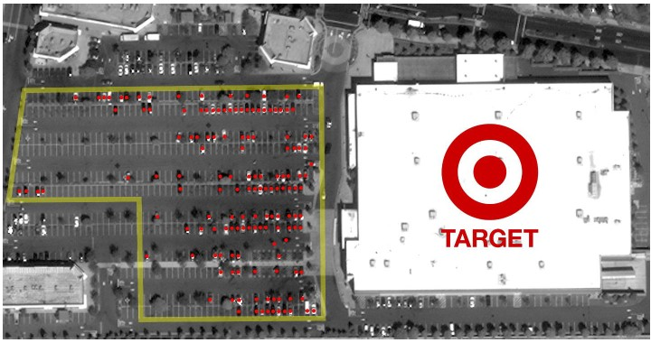

```{r}
#| label: load-packages-r
#| include: false
library(tidyverse)
library(nanoparquet)
library(tidymodels)
library(scales)
library(patchwork)

months_per_year <- 12

# Colours of the slides, used by the figures
ku_red <- "#901A1E"
jet <- "#3d3d3d"
grey <- "#666666"
light <- "#e6e3df"
theme_set(
  theme_minimal(base_size = 14) + theme(panel.grid.minor = element_blank())
)

source("lecture-slides/_live-poll.R")
guess_poll <- "aef27-l10-plug-in-guess"
```

```{python}
#| label: load-packages-py
#| include: false
from datetime import date

import numpy as np
import polars as pl
from sklearn.base import clone
from sklearn.linear_model import ElasticNet, LinearRegression
from sklearn.metrics import make_scorer

months_per_year = 12
```

```{r}
#| label: download-anomalies
#| include: false
# The long-short returns of the Open Source Asset Pricing anomalies, release
# 2026.10, as in exercise 5
osap_url <- paste0(
  "https://huggingface.co/datasets/OpenSourceAP/CrossSection/resolve/",
  "Data-Release-2026.10/Portfolios/Full%20Sets%20OP/PredictorLSretWide.parquet"
)
osap_file <- "data/osap_long_short_returns.parquet"
if (!file.exists(osap_file)) {
  download.file(osap_url, osap_file, mode = "wb")
}
# All anomalies in the file, before the filter for complete data
n_osap <- ncol(read_parquet(osap_file)) - 1
```

```{r}
#| label: prepare-anomalies
#| ref-label: load-anomalies-r
#| include: false
# Runs the code of the slide "The factor zoo" here already, so that the
# first slides can name the number of anomalies
```

## Machine learning in finance

:::: {.columns}
::: {.column width="62%"}
- **Machine learning:** flexible models with many parameters, regularization against overfitting, and fast algorithms to search over many models (Gu, Kelly & Xiu, 2020)
- **New data:** satellite images, text of filings and news

**Why it is hard in finance** (Kelly & Xiu, 2023):

- **Small data:** a few hundred months, and new data arrive only as time passes. Markets evolve, so the effective sample is even smaller
- **Efficient markets:** competition trades predictability away, so the signal-to-noise ratio is low
- **Economic structure helps:** the more structure a model imposes, the fewer parameters it has to estimate from the data
:::
::: {.column width="38%"}
{width=100%}
:::
::::

## From 27 stocks to `r length(anomaly_names)` anomalies

- **Lectures 2 to 5:** with 27 Dow Jones stocks, the plug-in portfolio already failed out of sample, and shrinkage helped
- **Lectures 7 to 9:** a portfolio sort turns a characteristic into a long-short portfolio. Researchers have published hundreds of them: the factor zoo
- **The question:** which combination of the zoo should an investor hold? The mean-variance efficient portfolio of the anomalies is also the SDF that prices them (lecture 6)
- **The SDF does not prescribe OLS:** theory says which portfolio to hold, not how to estimate its weights. The weights may also depend non-linearly on characteristics (lectures 13 and 14)

::: {.highlight}
**Today:** the plug-in portfolio of all `r length(anomaly_names)` anomalies overfits; ridge regression and the lasso trade a little bias for much less variance. All three run through the same machine learning workflow
:::

## The machine learning workflow

| Step | R: tidymodels | Python: scikit-learn |
|:-------------------------------------|:---------------------------------|:---------------------------|
| **1. Split** the months by date into an estimation and a test sample | `make_splits()`, `training()`, `testing()` | `.filter()` on the date |
| **2. Specify** the model, its engine and the penalty | `linear_reg()`, `set_engine()`, `workflow()` | `LinearRegression()`, `ElasticNet()` |
| **3. Resample and tune:** choose the penalty with the estimation sample only | `group_vfold_cv()`, `tune_grid()`, `select_best()` | `GroupKFold()`, `GridSearchCV()` |
| **4. Fit** the model with this penalty on the whole estimation sample | `finalize_workflow()`, `fit()` | `set_params()`, `.fit()` |
| **5. Evaluate** the fitted model once, in the test sample, with a metric | `augment()`, a yardstick metric | `.predict()`, `make_scorer()` |

::: {.highlight}
The same steps for every model of lectures 10 to 15. Today: steps 1, 2, 4 and 5 for every penalty on a grid; lecture 11 adds step 3
:::

## The factor zoo

::: {.panel-tabset group="language"}
## R

```{r}
#| label: load-anomalies-r
#| eval: false
# One sample split for all machine learning lectures
sample_start <- ymd("1973-01-01")
sample_end <- ymd("2023-12-31")
test_start <- ymd("2000-01-01")

anomalies <- read_parquet("data/osap_long_short_returns.parquet") |>
  filter(between(date, sample_start, sample_end)) |>
  select(date, where(\(x) !anyNA(x))) |>
  mutate(across(-date, \(x) x / 100), y = 1)
anomaly_names <- setdiff(names(anomalies), c("date", "y"))
sample_split <- make_splits(
  filter(anomalies, date < test_start),
  assessment = filter(anomalies, date >= test_start)
)
estimation_months <- training(sample_split)
test_months <- testing(sample_split)
```

## Python

```{python}
#| label: load-anomalies-py
#| eval: false
# One sample split for all machine learning lectures
sample_start = date(1973, 1, 1)
sample_end = date(2023, 12, 31)
test_start = date(2000, 1, 1)

anomalies = pl.read_parquet("data/osap_long_short_returns.parquet").filter(
    pl.col("date").is_between(sample_start, sample_end)
)
anomaly_names = [
    c for c in anomalies.columns if c != "date" and anomalies[c].null_count() == 0
]
anomalies = anomalies.select("date", pl.col(anomaly_names) / 100, y=pl.lit(1.0))
estimation_months = anomalies.filter(pl.col("date") < test_start)
test_months = anomalies.filter(pl.col("date") >= test_start)
```
:::

Open Source Asset Pricing (Chen & Zimmermann), as in exercise 5; the file stores returns in percent. `r length(anomaly_names)` of the `r n_osap` long-short anomalies have a return in every month; `y`, a one in every month, is the target of today's regressions. Estimation sample `r year(sample_start)`–`r year(test_start) - 1` (`r nrow(estimation_months)` months), test `r year(test_start)`–`r year(sample_end)` (`r nrow(test_months)`)

## The plug-in portfolio of the zoo

- The mean-variance efficient weights are proportional to $\hat\Sigma^{-1}\hat\mu$. Britten-Jones (1999): the same weights come from an OLS regression without an intercept, of the number one on the vector $F_t$ of the $N$ anomaly returns in month $t$

$$
1 = b'F_t + u_t, \qquad t = 1, \dots, T
$$

::: {.panel-tabset group="language"}
## R

```{r}
#| label: plug-in-r
# OLS without an intercept (0 +): the weights of the plug-in portfolio
plug_in_workflow <- workflow() |>
  add_variables(outcomes = y, predictors = all_of(anomaly_names)) |>
  add_model(linear_reg(), formula = y ~ 0 + .)
plug_in_fit <- fit(plug_in_workflow, estimation_months)
```

## Python

```{python}
#| label: plug-in-py
#| eval: false
x_estimation = estimation_months.select(anomaly_names)
y_estimation = estimation_months["y"]
x_test = test_months.select(anomaly_names)
y_test = test_months["y"]

plug_in = LinearRegression(fit_intercept=False).fit(x_estimation, y_estimation)
```
:::

- `workflow()` bundles the variables and the model: `linear_reg()` with its default engine, `lm()`. `r length(anomaly_names)` weights from `r nrow(estimation_months)` months
- The fitted values $\hat b'F_t$ are the returns of the portfolio $\hat b$: the Sharpe ratio of the predictions is the Sharpe ratio of the portfolio. Unlike the squared error, it does not depend on how much of the portfolio we hold

## The Sharpe ratio as a metric

::: {.panel-tabset group="language"}
## R

```{r}
#| label: metric-r
#| results: hide
# Predictions b'F_t are the portfolio's returns; y (truth) does not enter
sharpe_ratio_vec <- function(truth, estimate, ...) {
  mean(estimate) / sd(estimate) * sqrt(months_per_year)
}
sharpe_ratio <- function(data, truth, estimate, ...) {
  numeric_metric_summarizer(
    "sharpe_ratio",
    sharpe_ratio_vec,
    data,
    !!enquo(truth),
    !!enquo(estimate)
  )
}
sharpe_ratio <- new_numeric_metric(sharpe_ratio, direction = "maximize")

augment(plug_in_fit, estimation_months) |> sharpe_ratio(y, .pred)
```

## Python

```{python}
#| label: metric-py
#| eval: false
# Predictions b'F_t are the portfolio's returns; y does not enter
def sharpe_ratio(y, y_pred):
    return y_pred.mean() / y_pred.std(ddof=1) * np.sqrt(months_per_year)


sharpe_scorer = make_scorer(sharpe_ratio)
sharpe_scorer(plug_in, x_estimation, y_estimation)
```
:::

```{r}
#| label: plug-in-sharpe
#| include: false
# Sharpe ratios of a fitted workflow in both samples, for the figures
sample_sharpe <- function(fit) {
  c(
    estimation = sharpe_ratio_vec(
      estimation_months$y,
      predict(fit, estimation_months)$.pred
    ),
    test = sharpe_ratio_vec(test_months$y, predict(fit, test_months)$.pred)
  )
}
plug_in_sharpe <- sample_sharpe(plug_in_fit)
if (live) {
  ojs_define(
    poll_base = poll_base,
    guess_poll = guess_poll,
    test_years = paste0(year(test_start), "–", year(sample_end))
  )
}
```

In the estimation sample, the plug-in portfolio has an annualized Sharpe ratio of **`r number(plug_in_sharpe[["estimation"]], 0.1)`**. `metric_set(sharpe_ratio)` and `sharpe_scorer` let lecture 11 choose penalties by this metric

## Sharpe ratios in both samples

```{r}
#| label: market-and-equal-weights
#| include: false
# Annualized Sharpe ratios in both samples, as in lectures 2 to 5
market <- read_parquet("data/factors_ff3_monthly.parquet") |>
  filter(between(date, sample_start, sample_end))
market_sharpe <- c(
  estimation = sharpe_ratio_vec(
    estimate = market$mkt_excess[market$date < test_start]
  ),
  test = sharpe_ratio_vec(
    estimate = market$mkt_excess[market$date >= test_start]
  )
)
# 1/N: the average return of all anomalies in each month
equal_sharpe <- c(
  estimation = sharpe_ratio_vec(
    estimate = rowMeans(estimation_months[anomaly_names])
  ),
  test = sharpe_ratio_vec(estimate = rowMeans(test_months[anomaly_names]))
)

# The two samples in figures and tables
sample_years <- c(
  estimation = paste0(year(sample_start), "–", year(test_start) - 1),
  test = paste0(year(test_start), "–", year(sample_end))
)
sample_names <- c(
  estimation = paste("Estimation", sample_years[["estimation"]]),
  test = paste("Test", sample_years[["test"]])
)
```

- **Market:** Sharpe ratio `r number(market_sharpe[["estimation"]], 0.01)` until `r year(test_start) - 1`, `r number(market_sharpe[["test"]], 0.01)` since `r year(test_start)`
- **1/N over all anomalies:** `r number(equal_sharpe[["estimation"]], 0.01)` until `r year(test_start) - 1`, `r number(equal_sharpe[["test"]], 0.01)` since `r year(test_start)`. Diversifying across the zoo beats the market by far, but the anomalies lost `r percent(1 - equal_sharpe[["test"]] / equal_sharpe[["estimation"]])` of their Sharpe ratio after `r year(test_start) - 1`

## Your guess: the Sharpe ratio since `r year(test_start)`

::: {.content-visible when-profile="live"}


:::: {.columns}
::: {.column width="40%"}
```{ojs}
//| label: guess-poll-qr
//| echo: false
pollQR(guess_poll, [])
```
:::
::: {.column width="60%"}
```{ojs}
//| label: guess-poll-live
//| echo: false
guesses = pollAnswers(guess_poll)
guesses === null ? md`*Cannot reach the poll on eumel.*` : Plot.plot({
  width: 600,
  height: 380,
  x: {label: `Your guess: Sharpe ratio ${test_years}`},
  y: {label: "Answers", grid: true},
  marks: [
    Plot.rectY(guesses.filter(d => typeof d.value === "number"), Plot.binX({y: "count"}, {x: "value", fill: "#901A1E", thresholds: 20})),
    Plot.ruleY([0])
  ]
})
```
:::
::::
:::

::: {.content-visible unless-profile="live"}
In the estimation sample, the plug-in portfolio of the zoo has a Sharpe ratio of `r number(plug_in_sharpe[["estimation"]], 0.1)`. What is its Sharpe ratio from `r year(test_start)` to `r year(sample_end)`, with the weights estimated until `r year(test_start) - 1`?
:::

## Overfitting

```{r}
#| label: plot-overfitting
#| echo: false
#| fig-width: 10
#| fig-height: 4
portfolio_names <- c("Market", "1/N", "Plug-in")
overfitting <- tibble(
  portfolio = factor(portfolio_names, levels = portfolio_names),
  estimation = c(
    market_sharpe[["estimation"]],
    equal_sharpe[["estimation"]],
    plug_in_sharpe[["estimation"]]
  ),
  test = c(
    market_sharpe[["test"]],
    equal_sharpe[["test"]],
    plug_in_sharpe[["test"]]
  )
) |>
  pivot_longer(-portfolio, names_to = "sample", values_to = "sharpe") |>
  mutate(sample = sample_names[sample])

ggplot(overfitting, aes(x = portfolio, y = sharpe, fill = sample)) +
  geom_col(position = position_dodge(width = 0.75), width = 0.7) +
  geom_text(
    aes(label = number(sharpe, 0.01)),
    position = position_dodge(width = 0.75),
    vjust = -0.4,
    size = 4.5
  ) +
  scale_fill_manual(values = c(light, ku_red)) +
  scale_y_continuous(expand = expansion(mult = c(0, 0.12))) +
  labs(x = NULL, y = "Sharpe ratio (annualized)", fill = NULL) +
  theme(legend.position = "bottom")
```

- In the test sample, the plug-in portfolio keeps `r percent(plug_in_sharpe[["test"]] / plug_in_sharpe[["estimation"]])` of its Sharpe ratio: the weights fit the noise of `r nrow(estimation_months)` months as well as the signal
- Still `r number(plug_in_sharpe[["test"]], 0.01)` against `r number(equal_sharpe[["test"]], 0.01)` for 1/N: the estimated weights beat equal weights, despite their noise. The rest of the lecture estimates them with less noise

# The bias-variance trade-off

## Bias, variance and noise

::: {.box}
A new observation $y = f(x) + \varepsilon$ and an estimate $\hat f(x)$ from a sample. Where does the expected squared error $E\big[(y - \hat f(x))^2\big]$ of the estimate come from?
:::

::: {.fragment}
$$
E\big[(y - \hat f(x))^2\big] = \underbrace{\big(f(x) - E[\hat f(x)]\big)^2}_{\text{bias}^2} + \underbrace{\text{Var}\big(\hat f(x)\big)}_{\text{variance}} + \underbrace{\sigma_\varepsilon^2}_{\text{noise}}
$$

- OLS is unbiased, but with `r length(anomaly_names)` regressors and `r nrow(estimation_months)` months its variance is huge
- A little bias for much less variance: a **penalty** on large coefficients. The same idea as the shrinkage of covariance matrices in lecture 4
:::

## Ridge regression

::: {.box}
$$
\hat b^{\text{ridge}}_\lambda = \arg\min_b \ \underbrace{(y - Fb)'(y - Fb)}_{\text{sum of squared errors}} + T\lambda\, b'b
$$

On the zoo: $y$ is a vector of $T$ ones, $F$ has one row of anomaly returns $F_t'$ per month. $\lambda$ is the penalty (`penalty` in `linear_reg()`), not the risk premium of lectures 7–8; the factor $T$ makes it mean the same for any sample length
:::

::: {.fragment}
$$
\hat b^{\text{ridge}}_\lambda = (F'F + T\lambda I)^{-1}F'y = \sum_{j=1}^{N} q_j\, \frac{q_j'\hat\mu}{\ell_j + \lambda}
$$

- **Principal components:** $q_j$ and $\ell_j$ are the eigenvectors and eigenvalues of $F'F/T$. Portfolio $q_j$ earns $q_j'\hat\mu$ on average; $\ell_j$ is its average squared return
- $\lambda = 0$: the plug-in portfolio. $\lambda \to \infty$: $\hat b^{\text{ridge}}_\lambda \approx \hat\mu / \lambda \to 0$; scaled to absolute weights that sum to one, the weights follow the average returns, as if the anomalies were uncorrelated with equal variances
- Ridge shrinks portfolio $j$ by $\ell_j / (\ell_j + \lambda)$, most where $\ell_j$ is small: combinations that look best in the sample, partly because their variance is underestimated (lecture 4)
:::

## Ridge in the workflow

::: {.panel-tabset group="language"}
## R

```{r}
#| label: ridge-model-r
ridge_lambdas <- 10^seq(-7, -1, by = 0.25)
ridge_model <- linear_reg(penalty = tune(), mixture = 0) |>
  set_engine(
    "glmnet",
    intercept = FALSE,
    standardize = FALSE,
    path_values = ridge_lambdas,
    control = list(thresh = 1e-12) # tight, so that R and Python agree
  )
ridge_workflow <- update_model(plug_in_workflow, ridge_model)
```

## Python

```{python}
#| label: ridge-model-py
#| eval: false
ridge_lambdas = 10 ** np.arange(-7, -0.99, 0.25)
# l1_ratio=0: the ridge penalty; tight tolerance, so that R and Python agree
ridge_model = ElasticNet(l1_ratio=0, fit_intercept=False, tol=1e-8, max_iter=1_000_000)
```
:::

- **glmnet** with `mixture = 0` minimizes the ridge objective divided by $2T$, with $\lambda$ as on the last slide. `penalty = tune()` leaves $\lambda$ open; `path_values`: glmnet fits all penalties of the grid in one run
- **scikit-learn's `ElasticNet()`** with `l1_ratio=0` minimizes the same objective as glmnet: its penalty alpha is $\lambda$

## Ridge on the zoo

::: {.panel-tabset group="language"}
## R

```{r}
#| label: ridge-path-r
# The Sharpe ratio of a fitted workflow in some months
sharpe_in <- function(fit, months) {
  augment(fit, months) |> sharpe_ratio(y, .pred) |> pull(.estimate)
}

# Each penalty: fit on the estimation months, evaluate in both samples
ridge_path <- tibble(lambda = ridge_lambdas) |>
  mutate(
    fit = map(lambda, \(lambda) {
      ridge_workflow |>
        finalize_workflow(tibble(penalty = lambda)) |>
        fit(estimation_months)
    }),
    estimation = map_dbl(fit, \(fit) sharpe_in(fit, estimation_months)),
    test = map_dbl(fit, \(fit) sharpe_in(fit, test_months))
  )
```

## Python

```{python}
#| label: ridge-path-py
#| eval: false
# Each penalty: fit on the estimation months, evaluate in both samples
ridge_path = []
for lam in ridge_lambdas:
    ridge = clone(ridge_model).set_params(alpha=lam)
    ridge.fit(x_estimation, y_estimation)
    ridge_path.append(
        {
            "lambda": lam,
            "estimation": sharpe_scorer(ridge, x_estimation, y_estimation),
            "test": sharpe_scorer(ridge, x_test, y_test),
        }
    )
ridge_path = pl.DataFrame(ridge_path)
```
:::

`finalize_workflow()` and `set_params()` set the penalty, `fit()` estimates the weights, `sharpe_in()` and `sharpe_scorer` evaluate them: in hindsight also in the test sample

## The penalty in action

```{r}
#| label: ridge-weight-shares
#| include: false
# Weights as shares of the gross position, sorted, for each penalty
ridge_shares <- ridge_path |>
  mutate(
    share = map(fit, \(fit) {
      weights <- tidy(fit) |>
        filter(term != "(Intercept)") |>
        pull(estimate)
      sort(weights / sum(abs(weights)), decreasing = TRUE)
    })
  ) |>
  select(lambda, share) |>
  unnest(share) |>
  mutate(rank = row_number(), .by = lambda)
# The weights for the smallest penalty, the one that cross-validation picks in
# lecture 11, and the largest
cross_validated_lambda <- 1e-4
shown_lambdas <- c(
  min(ridge_lambdas),
  cross_validated_lambda,
  max(ridge_lambdas)
)

if (live) {
  ojs_define(
    ridge_path = ridge_path |> select(lambda, estimation, test),
    ridge_shares = ridge_shares,
    ridge_lambdas = ridge_lambdas,
    sample_names = unname(sample_names)
  )
}
```

::: {.content-visible when-profile="live"}
```{ojs}
//| label: ridge-slider
//| echo: false
viewof ridge_index = Inputs.range([0, ridge_lambdas.length - 1], {step: 1, value: 0, width: 520, label: "Penalty λ",
  format: i => Number(ridge_lambdas[i].toPrecision(2))})
ridge_lambda_now = ridge_lambdas[ridge_index]
```

:::: {.columns}
::: {.column width="50%"}
```{ojs}
//| label: ridge-weights-live
//| echo: false
Plot.plot({
  width: 470,
  height: 360,
  x: {label: "Anomalies, sorted by weight", ticks: []},
  y: {label: "Weight (absolute weights sum to 100%)", tickFormat: "%", domain: [-0.08, 0.08], clamp: true, grid: true},
  marks: [
    Plot.ruleY([0], {stroke: "#b3b3b3"}),
    Plot.barY(transpose(ridge_shares).filter(d => d.lambda === ridge_lambda_now), {x: "rank", y: "share", fill: "#3d3d3d"})
  ]
})
```
:::
::: {.column width="50%"}
```{ojs}
//| label: ridge-sharpe-live
//| echo: false
Plot.plot({
  width: 470,
  height: 360,
  x: {label: "Penalty λ", type: "log"},
  y: {label: "Sharpe ratio (annualized)", grid: true},
  color: {legend: true, domain: sample_names, range: ["#b3b3b3", "#901A1E"]},
  marks: [
    Plot.line(transpose(ridge_path), {x: "lambda", y: "estimation", stroke: () => sample_names[0], strokeWidth: 2}),
    Plot.line(transpose(ridge_path), {x: "lambda", y: "test", stroke: () => sample_names[1], strokeWidth: 2}),
    Plot.dot(transpose(ridge_path).filter(d => d.lambda === ridge_lambda_now), {x: "lambda", y: "estimation", fill: "#b3b3b3", r: 7}),
    Plot.dot(transpose(ridge_path).filter(d => d.lambda === ridge_lambda_now), {x: "lambda", y: "test", fill: "#901A1E", r: 7}),
    Plot.text(transpose(ridge_path).filter(d => d.lambda === ridge_lambda_now), {x: "lambda", y: "test", dy: -16,
      text: d => d.test.toFixed(2), fill: "#901A1E"})
  ]
})
```
:::
::::
:::

::: {.content-visible unless-profile="live"}
```{r}
#| label: plot-ridge-path
#| echo: false
#| fig-width: 11
#| fig-height: 4.3
sharpe_panel <- ridge_path |>
  select(lambda, estimation, test) |>
  pivot_longer(-lambda, names_to = "sample", values_to = "sharpe") |>
  mutate(sample = sample_names[sample]) |>
  ggplot(aes(x = lambda, y = sharpe, color = sample)) +
  geom_line(linewidth = 1) +
  scale_x_log10(labels = label_log()) +
  scale_color_manual(values = c("#b3b3b3", ku_red)) +
  labs(x = "Penalty λ", y = "Sharpe ratio (annualized)", color = NULL)
# λ = 10 to the power of the exponent, written with superscript digits
power_label <- function(x) {
  paste0("λ = 10", chartr("-0123456789", "⁻⁰¹²³⁴⁵⁶⁷⁸⁹", round(log10(x))))
}
weights_panel <- ridge_shares |>
  filter(lambda %in% shown_lambdas) |>
  mutate(
    penalty = factor(power_label(lambda), levels = power_label(shown_lambdas))
  ) |>
  ggplot(aes(x = rank, y = share, color = penalty)) +
  geom_hline(yintercept = 0, color = grey) +
  geom_line(linewidth = 1) +
  scale_y_continuous(labels = percent) +
  scale_color_manual(values = c(jet, ku_red, "#b3b3b3")) +
  labs(
    x = "Anomalies, sorted by weight",
    y = "Weight\n(absolute weights sum to 100%)",
    color = "Penalty"
  )
weights_panel + sharpe_panel & theme(legend.position = "bottom")
```
:::

- Small penalties bet heavily long and short on a few combinations; large ones spread the weights
- The larger $\lambda$, the lower the Sharpe ratio in the estimation sample. In the test sample, the Sharpe ratio first rises, from `r number(ridge_path$test[1], 0.01)` to `r number(max(ridge_path$test), 0.01)`, then falls

## The lasso

::: {.box}
$$
\hat b^{\text{lasso}}_\lambda = \arg\min_b \ (y - Fb)'(y - Fb) + 2T\lambda \sum_{i=1}^{N} |b_i|
$$
:::

::: {.fragment}
:::: {.columns}
::: {.column width="58%"}
- No closed form. If $F'F = TI$ (uncorrelated anomalies with mean square one), each weight is **soft-thresholded**:

$$
\hat b^{\text{lasso}}_{\lambda, i} = \text{sign}\big(\hat b_i^{\text{OLS}}\big)\max\big(|\hat b_i^{\text{OLS}}| - \lambda, 0\big)
$$

- The same problem with a budget instead of a penalty: the weights with the smallest squared error (dots) within the diamond (lasso) or the disk (ridge). The diamond's corners set weights to exactly zero: the lasso **selects** anomalies
- **Elastic net:** a mix of both penalties, for groups of similar anomalies
:::
::: {.column width="42%"}
```{r}
#| label: plot-lasso-ridge
#| echo: false
#| fig-width: 5
#| fig-height: 5
# Two weights: contours of the squared error around the OLS estimate, and
# the best weights within a budget for the absolute (lasso) and squared
# (ridge) weights
b_ols <- c(1.1, 1.9)
error_matrix <- matrix(c(1, 0.5, 0.5, 1.6), 2)
budget <- 1
squared_error <- function(b1, b2) {
  map2_dbl(b1, b2, \(b1, b2) {
    deviation <- c(b1, b2) - b_ols
    drop(deviation %*% error_matrix %*% deviation)
  })
}
angle <- seq(0, 2 * pi, length.out = 3601)
diamond <- tibble(
  b1 = budget * cos(angle) / (abs(cos(angle)) + abs(sin(angle))),
  b2 = budget * sin(angle) / (abs(cos(angle)) + abs(sin(angle)))
) |>
  mutate(error = squared_error(b1, b2))
disk <- tibble(b1 = budget * cos(angle), b2 = budget * sin(angle)) |>
  mutate(error = squared_error(b1, b2))
best <- bind_rows(
  lasso = slice_min(diamond, error, n = 1),
  ridge = slice_min(disk, error, n = 1),
  .id = "method"
)
# Each contour: all weights with the same squared error
error_root <- with(
  eigen(error_matrix),
  vectors %*% diag(1 / sqrt(values)) %*% t(vectors)
)
contours <- map(c(best$error, best$error[2] / 4), \(level) {
  points <- b_ols + sqrt(level) * error_root %*% rbind(cos(angle), sin(angle))
  tibble(b1 = points[1, ], b2 = points[2, ], level = level)
}) |>
  bind_rows()

ggplot(mapping = aes(x = b1, y = b2)) +
  geom_hline(yintercept = 0, color = grey) +
  geom_vline(xintercept = 0, color = grey) +
  geom_path(data = contours, aes(group = level), color = "#b3b3b3") +
  geom_polygon(data = diamond, fill = ku_red, alpha = 0.15, color = ku_red) +
  geom_path(data = disk, color = jet, linetype = "dashed") +
  geom_point(data = best, aes(color = method), size = 3) +
  annotate("point", x = b_ols[1], y = b_ols[2], color = jet, size = 3) +
  annotate(
    "label",
    x = c(b_ols[1] + 0.12, best$b1[1] - 0.1, best$b1[2] + 0.12),
    y = c(b_ols[2], best$b2[1] + 0.12, best$b2[2]),
    label = c("OLS", "Lasso", "Ridge"),
    hjust = c(0, 1, 0),
    color = c(jet, ku_red, jet),
    size = 7,
    border.colour = NA,
    label.padding = unit(0.1, "lines")
  ) +
  scale_color_manual(values = c(lasso = ku_red, ridge = jet), guide = "none") +
  coord_equal() +
  labs(x = expression(b[1]), y = expression(b[2])) +
  theme(
    panel.grid = element_blank(),
    axis.text = element_blank(),
    axis.title = element_text(size = 20)
  )
```
:::
::::
:::

## The lasso in code

::: {.panel-tabset group="language"}
## R

```{r}
#| label: lasso-path-r
lasso_lambdas <- 10^seq(-6, -2.5, by = 0.25)
lasso_model <- linear_reg(penalty = tune(), mixture = 1) |>
  set_engine(
    "glmnet",
    intercept = FALSE,
    standardize = FALSE,
    path_values = lasso_lambdas,
    control = list(thresh = 1e-12)
  )
lasso_workflow <- update_model(plug_in_workflow, lasso_model)
lasso_path <- tibble(lambda = lasso_lambdas) |>
  mutate(
    fit = map(lambda, \(lambda) {
      lasso_workflow |>
        finalize_workflow(tibble(penalty = lambda)) |>
        fit(estimation_months)
    }),
    anomalies = map_dbl(fit, \(fit) sum(tidy(fit)$estimate != 0))
  )
```

## Python

```{python}
#| label: lasso-path-py
#| eval: false
lasso_lambdas = 10 ** np.arange(-6, -2.49, 0.25)
lasso_model = ElasticNet(l1_ratio=1, fit_intercept=False, tol=1e-8, max_iter=1_000_000)

lasso_path = []
for lam in lasso_lambdas:
    lasso = clone(lasso_model).set_params(alpha=lam)
    lasso.fit(x_estimation, y_estimation)
    lasso_path.append({"lambda": lam, "anomalies": int(np.sum(lasso.coef_ != 0))})
lasso_path = pl.DataFrame(lasso_path)
```
:::

```{r}
#| label: lasso-sharpe
#| include: false
# Sharpe ratios of the lasso fits in both samples, as for ridge
lasso_path <- lasso_path |>
  mutate(
    estimation = map_dbl(fit, \(fit) sharpe_in(fit, estimation_months)),
    test = map_dbl(fit, \(fit) sharpe_in(fit, test_months))
  )
```

`mixture = 1` and `l1_ratio=1`: the lasso. glmnet and `ElasticNet()` minimize the lasso objective divided by $2T$; alpha = $\lambda$

## The lasso on the zoo

```{r}
#| label: plot-lasso-path
#| echo: false
#| fig-width: 11
#| fig-height: 4
count_panel <- ggplot(lasso_path, aes(x = lambda, y = anomalies)) +
  geom_line(color = jet, linewidth = 1) +
  geom_point(color = jet) +
  scale_x_log10(labels = label_log()) +
  labs(x = "Penalty λ", y = "Anomalies with\na non-zero weight")
lasso_sharpe_panel <- lasso_path |>
  pivot_longer(
    c(estimation, test),
    names_to = "sample",
    values_to = "sharpe"
  ) |>
  mutate(sample = sample_names[sample]) |>
  ggplot(aes(x = lambda, y = sharpe, color = sample)) +
  geom_line(linewidth = 1) +
  scale_x_log10(labels = label_log()) +
  scale_color_manual(values = c("#b3b3b3", ku_red)) +
  labs(x = "Penalty λ", y = "Sharpe ratio (annualized)", color = NULL)
count_panel + lasso_sharpe_panel & theme(legend.position = "bottom")
```

- The larger $\lambda$, the fewer anomalies get a non-zero weight
- In hindsight, `r lasso_path$anomalies[which.max(lasso_path$test)]` anomalies do best in the test sample (Sharpe ratio `r number(max(lasso_path$test), 0.01)`), better than all of them. But picking $\lambda$ by the test sample would be overfitting again

## Scoreboard

```{r}
#| label: scoreboard
#| echo: false
tibble(
  Portfolio = c("Market", "1/N over all anomalies", "Plug-in mean-variance"),
  Anomalies = c("–", length(anomaly_names), length(anomaly_names)),
  estimation = number(
    c(
      market_sharpe[["estimation"]],
      equal_sharpe[["estimation"]],
      plug_in_sharpe[["estimation"]]
    ),
    0.01
  ),
  test = number(
    c(
      market_sharpe[["test"]],
      equal_sharpe[["test"]],
      plug_in_sharpe[["test"]]
    ),
    0.01
  )
) |>
  rename_with(
    \(sample) paste("Sharpe ratio", sample_years[sample]),
    c(estimation, test)
  )
```

- Ridge and the lasso beat the plug-in portfolio in the test sample for a wide range of penalties, but which $\lambda$ do we choose without looking at the test sample?
- **Lecture 11:** choosing the penalty by cross-validation, and an economic reason for it, the ridge SDF of Kozak, Nagel & Santosh (2020)
