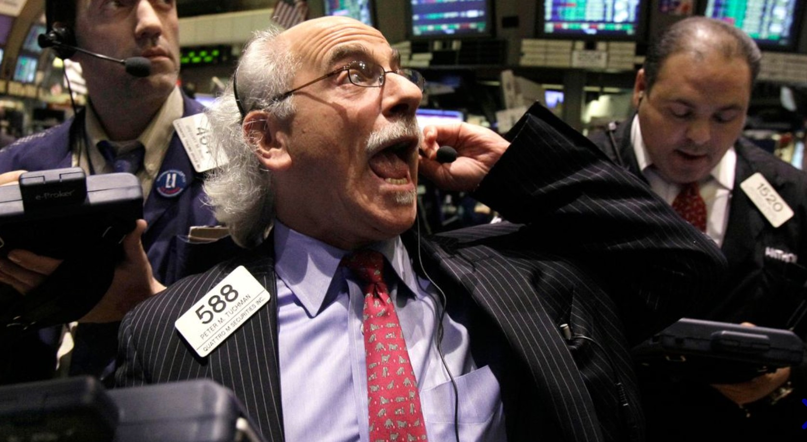
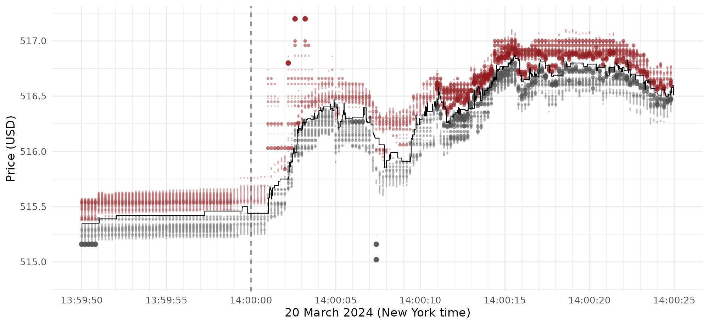

```{r}
#| label: load-packages-r
#| include: false
library(tidyverse)
library(tidyfinance)
library(scales)
library(patchwork)

# A recent year: the intraday figures, and the comparisons with the first year
recent_year <- 2024

# The intraday figures average the snapshots over intervals of ten minutes
bucket_minutes <- 10

# Two crisis months: after the Lehman collapse, and the COVID-19 crash
crisis_years <- c(2009, 2020)

# Colours of the slides, used by the figures
ku_red <- "#901A1E"
jet <- "#3d3d3d"
grey <- "#666666"
light <- "#e6e3df"
theme_set(
  theme_minimal(base_size = 14) + theme(panel.grid.minor = element_blank())
)

source("lecture-slides/_live-poll.R")
```

```{python}
#| label: load-packages-py
#| include: false
from calendar import monthrange
from datetime import date

import polars as pl
import tidyfinance as tf
```

## From monthly returns to every order

:::::{.columns}

::: {.column width="44%"}
{width=100%}
:::
::: {.column width="56%"}

- **So far:** monthly returns, one number per stock and month
- **Below the surface:** NASDAQ has no trading floor. Every order is a message, time-stamped to the nanosecond: billions of messages a day across US stocks
- **Why:** trading costs (lecture 5 and the trading game), volatility measured within the day (lecture 17), covariances for portfolio choice (lecture 18)
- Assignment 3 on realized volatility from high-frequency data starts on 6 May

::: {.highlight}
**Today:** how a stock trades in the limit order book, high-frequency data from LOBSTER for SPY, liquidity and price impact
:::

:::
:::::

```{r}
#| label: hft-survey
#| include: false
# One survey with three guesses on the scale of high-frequency trading. The
# same questions and choices are in surveys/aef27-l16-hft.json on eumel
hft_survey <- "aef27-l16-hft"
hft_topics <- c("Speed", "Data", "Exchanges")
hft_texts <- c(
  "A round trip from Nasdaq's data centre in Carteret, New Jersey, to the Chicago data centres (e.g. CME's) and back, on the fastest fibre: how many fit into one blink of an eye?",
  "Which file is bigger: CRSP daily (every US stock on every trading day since 1926) or one day of SPY's order book from LOBSTER (the first 100 levels)?",
  "Which share of Nasdaq's net revenue in 2025 (revenue less the rebates and fees it pays per trade) came from trading on its exchanges?"
)
hft_choices <- list(
  c("Less than 1", "1 to 4", "5 to 50", "More than 50"),
  c(
    "CRSP 100 times bigger",
    "CRSP 10 times bigger",
    "About the same size",
    "SPY day twice as big"
  ),
  c("Less than 30%", "30% to 50%", "50% to 70%", "More than 70%")
)

# The questions as a numbered list, each with its choices on a grey line
hft_question_list <- function(font_size = "1em") {
  items <- paste0(
    seq_along(hft_topics),
    ". **",
    hft_topics,
    ":** ",
    hft_texts,
    "<br>[",
    map_chr(hft_choices, \(choices) paste(choices, collapse = " · ")),
    "]{style=\"color: ",
    grey,
    "\"}"
  )
  cat(
    paste0("::: {style=\"font-size: ", font_size, "\"}"),
    items,
    ":::",
    sep = "\n"
  )
}

# Milliseconds: a blink (BioNumbers 100706), a round trip between Nasdaq's
# data centre in Carteret and the Chicago data centres on the fastest fibre,
# and the same way by microwave (Nasdaq Chicago Microwave, 2016)
blink_ms <- c(100, 400)
round_trip_ms <- c(13, 15)
microwave_one_way_ms <- 4.09
round_trips <- c(
  min(blink_ms) / max(round_trip_ms),
  max(blink_ms) / min(round_trip_ms)
)

# MB: all of CRSP daily, and one day of SPY's order book from LOBSTER
# (16 November 2026, the first 100 levels, about 1 GB)
crsp_daily_mb <- 511
spy_day_mb <- 1000

# Nasdaq, full year 2025, USD million: net revenue is revenue less the
# rebates and fees paid per trade (transaction-based expenses)
net_revenue <- 5249
trading_net_revenue <- 1201
trading_gross_revenue <- 4170
trading_rebates <- 2528
data_and_listings <- 804

if (live) {
  ojs_define(poll_base = poll_base, hft_survey = hft_survey)
}
```

## Three guesses

::: {.content-visible when-profile="live"}


:::: {.columns}
::: {.column width="26%"}
```{ojs}
//| label: hft-survey-qr
//| echo: false
surveyQR(hft_survey, 220)
```
:::
::: {.column width="74%"}
```{r}
#| label: hft-questions-live
#| echo: false
#| results: asis
hft_question_list("0.8em")
```
:::
::::

::: {style="margin-top: 0.6em"}
```{ojs}
//| label: hft-survey-live
//| echo: false
hft_results = surveyResults(hft_survey)
surveyCharts(hft_results)
```
:::
:::

::: {.content-visible unless-profile="live"}
```{r}
#| label: hft-questions
#| echo: false
#| results: asis
hft_question_list()
```
:::

## The answers

1. **About `r round(round_trips[1])` to `r round(round_trips[2])` round trips.** A blink lasts `r blink_ms[1]` to `r blink_ms[2]` ms, a round trip on the fastest fibre `r round_trip_ms[1]` to `r round_trip_ms[2]` ms; microwave links take only `r microwave_one_way_ms` ms one way. Sources: BioNumbers 100706 (Harvard); Nasdaq Chicago Microwave (2016)
2. **One day of SPY, about `r round(spy_day_mb / crsp_daily_mb)` times as big.** SPY's order book on 16 November 2026 takes about `r spy_day_mb / 1000` GB, all of CRSP daily `r crsp_daily_mb` MB. Sources: a LOBSTER download (the first 100 levels); CRSP daily from WRDS
3. **`r percent(trading_net_revenue / net_revenue, 1)` from trading:** USD `r comma(trading_net_revenue)` million of USD `r comma(net_revenue)` million. Nasdaq paid `r percent(trading_rebates / trading_gross_revenue, 1)` of its gross trading revenue (USD `r comma(trading_gross_revenue)` million) back to traders as rebates. Most of its revenue comes from data, listings, indexes and technology: Data and Listing Services alone brought USD `r comma(data_and_listings)` million (`r percent(data_and_listings / net_revenue, 1)`). Source: Nasdaq, fourth quarter and full year 2025 results

# The limit order book

## How an order book works

::: {.box}
An exchange collects orders to buy and to sell. Which trades happen, and at which prices?
:::

::: {.fragment}
- **Limit order:** buy or sell up to a quantity at a stated price or better. Waits in the **order book** until it is executed or cancelled
- **Market order:** buy or sell a quantity now, at the best prices in the book
- **Best bid and best ask:** the highest buy and the lowest sell price. **Spread:** their difference; **midquote:** their average. **Depth:** the quantity waiting at a price
- **Price-time priority:** better prices first, at the same price the older order first
- A large market order walks up the book: it pays more than the best price, its **price impact**
:::

## An order book

```{r}
#| label: order-book
#| include: false
# A stylized order book, for illustration only
order_book <- bind_rows(
  tibble(
    price = 99.96 + 0.01 * 0:3,
    depth = c(700, 500, 400, 50),
    side = "Bid: buy orders"
  ),
  tibble(
    price = 100.00 + 0.01 * 0:3,
    depth = c(300, 700, 500, 700),
    side = "Ask: sell orders"
  )
)

# A market order to buy takes the cheapest sell orders first
market_buy <- 1300
asks <- order_book |>
  filter(side == "Ask: sell orders") |>
  mutate(
    taken = pmin(depth, pmax(market_buy - lag(cumsum(depth), default = 0), 0))
  )
fills <- asks |> filter(taken > 0)
cleared <- asks |> filter(taken == depth)
best_bid <- max(order_book$price[order_book$side == "Bid: buy orders"])
new_best_ask <- min(asks$price[asks$taken < asks$depth])
average_price <- weighted.mean(fills$price, fills$taken)
fill_text <- knitr::combine_words(
  paste(comma(fills$taken), "at", number(fills$price, 0.01)),
  oxford_comma = FALSE
)

# The book after the market order has taken the first `levels` ask levels:
# the shares it bought are drawn as dashed outlines
plot_book <- function(levels) {
  book <- order_book |>
    left_join(
      asks |> mutate(level = row_number()) |> select(price, taken, level),
      by = "price"
    ) |>
    mutate(
      bought = if_else(coalesce(level, 0L) %in% seq_len(levels), taken, 0),
      waiting = depth - bought
    )
  bought <- book |> filter(bought > 0)
  best_ask <- book |>
    filter(side == "Ask: sell orders", waiting > 0) |>
    pull(price) |>
    min()
  ggplot(book, aes(x = price)) +
    geom_col(aes(y = waiting, fill = side), width = 0.008) +
    geom_rect(
      data = bought,
      aes(
        xmin = price - 0.004,
        xmax = price + 0.004,
        ymin = waiting,
        ymax = depth
      ),
      fill = NA,
      color = ku_red,
      linetype = "dashed"
    ) +
    geom_text(
      data = bought,
      aes(y = (waiting + depth) / 2, label = paste0(comma(bought), "\nbought")),
      color = ku_red,
      size = 3.8,
      lineheight = 0.9
    ) +
    annotate(
      "segment",
      x = best_bid,
      xend = best_ask,
      y = 820,
      yend = 820,
      arrow = arrow(ends = "both", length = unit(0.15, "cm")),
      color = jet
    ) +
    annotate(
      "text",
      x = (best_bid + best_ask) / 2,
      y = 880,
      label = "Spread",
      color = jet
    ) +
    scale_fill_manual(
      values = c("Bid: buy orders" = "#b3b3b3", "Ask: sell orders" = ku_red),
      breaks = c("Bid: buy orders", "Ask: sell orders")
    ) +
    scale_x_continuous(
      breaks = order_book$price,
      labels = number_format(0.01)
    ) +
    labs(
      x = "Price (USD)",
      y = "Shares waiting",
      fill = NULL,
      caption = "Illustration"
    ) +
    theme(legend.position = "bottom")
}
```

:::: {.r-stack}
::: {.fragment .fade-out fragment-index=1}
```{r}
#| label: plot-order-book
#| echo: false
#| fig-width: 10
#| fig-height: 3.6
plot_book(0)
```
:::
::: {.fragment .fade-in-then-out fragment-index=1}
```{r}
#| label: plot-order-book-level-1
#| echo: false
#| fig-width: 10
#| fig-height: 3.6
plot_book(1)
```
:::
::: {.fragment .fade-in-then-out fragment-index=2}
```{r}
#| label: plot-order-book-level-2
#| echo: false
#| fig-width: 10
#| fig-height: 3.6
plot_book(2)
```
:::
::: {.fragment .fade-in fragment-index=3}
```{r}
#| label: plot-order-book-level-3
#| echo: false
#| fig-width: 10
#| fig-height: 3.6
plot_book(3)
```
:::
::::

- A market order to buy `r comma(market_buy)` shares walks up the book: it takes `r fill_text`

::: {.fragment fragment-index=3}
- The order clears the levels at `r knitr::combine_words(number(cleared$price, 0.01), oxford_comma = FALSE)` and moves the best ask up to `r number(new_best_ask, 0.01)`. The buyer pays `r number(average_price, 0.01)` per share on average, more than the best ask of `r number(asks$price[1], 0.01)` before the order: its **price impact**
:::

## A NASDAQ trading day

::: timeline
::: {.event data-label="9:30"}
**Opening auction**
:::
::: {.event data-label="9:30 to 16:00"}
**Continuous trading**: submissions, cancellations, executions; visible and hidden orders
:::
::: {.event data-label="16:00"}
**Closing auction**
:::
::: {.event data-label="After 16:00"}
**After-hours trading**
:::
:::

- Most of the trading volume of a US stock is not on its listing exchange: a stock listed on the NYSE also trades on NASDAQ and many other venues

# High-frequency data

## The order book when the Fed speaks

{width=80%}

- SPY on NASDAQ, 20 March 2024 (LOBSTER), every 0.2 seconds: the 20 best prices on each side. Red: sell orders, grey: buy orders, dot size: shares waiting, black: last trade price, dashed: the Fed's statement at 14:00
- Seconds after the statement, the book thins out, the price levels spread apart and the price jumps

## LOBSTER data

- [LOBSTER](https://lobsterdata.com) rebuilds the NASDAQ order book of any stock from the exchange's messages; KU has access
- **Message file:** one row per event: time (seconds after midnight, with nanoseconds), event type, order ID, size, price, direction (buy or sell limit order)
- **Event types:** submission of a new limit order, partial cancellation, deletion, execution of a visible order, execution of a hidden order, auction trade, trading halt
- **Order book file:** after every event, the best prices and the depth on each side, for as many levels as requested
- One stock and one day easily have millions of messages

## Ten messages after the Fed

```{r}
#| label: lobster-messages
#| echo: false
lobster_messages <- read_csv(
  "lecture-slides/figures/lobster-spy-2024-03-20-messages.csv",
  col_types = cols(.default = col_double())
)
# The last messages share one time stamp: one buy order that trades with
# several sell orders
sweep <- lobster_messages |>
  filter(time == max(time))
lobster_messages |>
  mutate(
    # The file stores seconds after midnight; shown as clock time
    time = sprintf(
      "%02d:%02d:%012.9f",
      time %/% 3600,
      time %% 3600 %/% 60,
      time %% 60
    ),
    # The file stores prices in 1/10,000 dollar; shown in dollars
    across(c(price, ask_price_1, bid_price_1), \(x) number(x / 1e4, 0.01)),
    order_id = sprintf("%.0f", order_id)
  ) |>
  knitr::kable(
    col.names = c(
      "Time",
      "Type",
      "Order ID",
      "Size",
      "Price",
      "Direction",
      "Ask",
      "Ask size",
      "Bid",
      "Bid size"
    ),
    align = "lrrrrrrrrr"
  )
```

- SPY, 20 March 2024, one second after the statement. Left: the message file; right: the best ask and bid of the order book file after each message. The file stores the time in seconds after midnight and prices in 1/10,000 dollar (`r sprintf("%.0f", sweep$price[1])` for `r dollar(sweep$price[1] / 1e4, 0.01)`), shown here as clock time and in dollars. Direction is the side of the limit order in the book: 1 buy, −1 sell
- Type 1 adds a limit order, 3 deletes one, 4 executes one. An executed sell order (−1) is a trade started by a buyer. The last `r nrow(sweep)` rows are one buy order of `r comma(sum(sweep$size))` shares that clears the sell orders at `r knitr::combine_words(dollar(unique(sweep$price) / 1e4, 0.01), oxford_comma = FALSE)` and moves the best ask to `r dollar(last(sweep$ask_price_1) / 1e4, 0.01)`

## The SPY data

::: {.panel-tabset group="language"}
## R

```{r}
#| label: download-spy-r
#| cache: true
# Five-second snapshots of the SPY order book during regular trading hours,
# for one month in every year
years <- 2008:2025
sample_month <- 3

spy <- map(years, \(year) {
  start <- make_date(year, sample_month, 1)
  download_data(
    domain = "Tidy Finance",
    dataset = "high_frequency_sp500",
    start_date = start,
    end_date = ceiling_date(start, "month") - days(1)
  ) |>
    mutate(year = year)
}) |>
  bind_rows()
```

## Python

```{python}
#| label: download-spy-py
#| eval: false
# Five-second snapshots of the SPY order book during regular trading hours,
# for one month in every year
years = range(2008, 2026)
sample_month = 3

spy = pl.concat(
    tf.download_data(
        domain="Tidy Finance",
        dataset="high_frequency_sp500",
        start_date=date(year, sample_month, 1),
        end_date=date(year, sample_month, monthrange(year, sample_month)[1]),
    ).with_columns(year=pl.lit(year))
    for year in years
)
```
:::

```{r}
#| label: month-label
#| include: false
# "March 2008": the sample month of a year, for the text and the figures
month_label <- \(year) paste(month.name[sample_month], year)
```

- SPY, the ETF on the S&P 500, on NASDAQ from July 2007, built from LOBSTER: every 5 seconds the midquote, the **spread** (basis points of the midquote), the **depth** at the best quotes and within 5 bps (shares), the **dollar volume** traded, and the **signed order flow** (buyer- minus seller-initiated shares)
- Here: `r month.name[sample_month]` of every year `r min(years)`–`r max(years)`, `r comma(nrow(spy))` snapshots

## Liquidity through the day

```{r}
#| label: plot-intraday
#| echo: false
#| fig-width: 11
#| fig-height: 3.6
# Medians over intervals of the trading day in one year, without the
# snapshots of the opening and closing auctions. Medians, because a mean
# follows the few days with news in an interval
intraday <- spy |>
  filter(year == recent_year) |>
  mutate(clock_exact = hour(ts) + minute(ts) / 60 + second(ts) / 3600) |>
  filter(clock_exact > 9.5 + 5 / 3600, clock_exact < 16) |>
  mutate(
    time = floor_date(ts, paste(bucket_minutes, "minutes")),
    clock = hour(time) + minute(time) / 60
  ) |>
  summarize(
    spread = median(spread, na.rm = TRUE),
    depth = median((depth0_ask + depth0_bid) / 2 * midquote, na.rm = TRUE),
    volume = median(trading_volume),
    .by = clock
  )
intraday_panel <- function(column, label, formatter) {
  ggplot(intraday, aes(x = clock, y = .data[[column]])) +
    geom_line(color = ku_red, linewidth = 0.9) +
    scale_x_continuous(
      breaks = c(10, 12, 14, 16),
      labels = c("10:00", "12:00", "14:00", "16:00")
    ) +
    scale_y_continuous(labels = formatter) +
    labs(x = NULL, y = label)
}
intraday_panel("spread", "Spread (bps)", number_format(0.01)) +
  intraday_panel(
    "depth",
    "Depth at the best quotes (USD)",
    label_dollar(scale = 1e-3, suffix = "k")
  ) +
  intraday_panel(
    "volume",
    "Volume per 5 seconds (USD)",
    label_dollar(scale = 1e-6, suffix = "m", accuracy = 0.1)
  )
```

- `r month_label(recent_year)`, medians of the snapshots in each `r bucket_minutes`-minute interval of continuous trading (without the opening and closing auctions). Medians, not means: a single day with news, such as a Fed announcement, does not drive the curve
- Trading is heaviest at the open and at the close (the U-shape); the spread is widest right after the open, when uncertainty is largest, and depth builds up during the day

## Liquidity over the years

```{r}
#| label: plot-yearly
#| echo: false
#| fig-width: 11
#| fig-height: 3.6
yearly <- spy |>
  summarize(
    spread = mean(spread, na.rm = TRUE),
    depth = mean((depth0_ask + depth0_bid) / 2 * midquote, na.rm = TRUE),
    .by = year
  )
crisis <- yearly |> filter(year %in% crisis_years)
spread_years <- ggplot(yearly, aes(x = year, y = spread)) +
  geom_line(color = jet) +
  geom_point(color = jet) +
  geom_point(data = crisis, color = ku_red, size = 3) +
  geom_text(
    data = crisis,
    aes(label = month_label(year)),
    vjust = -0.9,
    hjust = 0.2,
    color = ku_red,
    size = 3.8
  ) +
  scale_y_continuous(limits = c(0, NA), expand = expansion(mult = c(0, 0.15))) +
  labs(x = NULL, y = "Spread (bps)")
depth_years <- ggplot(yearly, aes(x = year, y = depth)) +
  geom_line(color = jet) +
  geom_point(color = jet) +
  scale_y_continuous(
    labels = label_dollar(scale = 1e-6, suffix = "m", accuracy = 0.1)
  ) +
  labs(x = NULL, y = "Depth at the best quotes (USD)")
spread_years + depth_years
```

- The spread fell from `r number(yearly$spread[yearly$year == min(years)], 0.01)` bps in `r month_label(min(years))` to `r number(yearly$spread[yearly$year == recent_year], 0.01)` bps in `r month_label(recent_year)`, and rose again to `r number(yearly$spread[yearly$year == max(years)], 0.01)` bps in `r month_label(max(years))`. SPY trades at the minimum tick of one cent, which became ever smaller relative to the price. Crises widen the spread: `r month_label(crisis$year[1])` and `r month_label(crisis$year[2])`
- Depth at the best quotes shrank as well, with smaller orders spread over more trading venues

# Price impact

## Kyle's lambda

::: {.box}
Kyle (1985): an informed trader knows the asset's value $v$; everyone else expects $p_0 = E[v]$ before trading. A market maker sees only the total order flow $x$, from the informed and from uninformed traders. Which price does she set?
:::

::: {.fragment}
$$
p = E[v \mid x] = p_0 + \lambda\, x \qquad \text{with} \qquad \lambda = \frac{\text{Cov}(v, x)}{\text{Var}(x)}
$$

- Buying pushes the price up because buying may be informed. $\lambda$ measures illiquidity: the larger, the more a trade moves the price
- A trade of size $q$ costs about $\lambda q \cdot q$: costs grow with the square of the trade, the **quadratic costs** of lecture 5
:::

## Price impact in code

::: {.panel-tabset group="language"}
## R

```{r}
#| label: price-impact-r
# Midquote returns (bps) on net buying in USD million per interval:
# signed shares times the midquote of their snapshot. signed_volume is
# missing in snapshots without trades
interval_length <- "1 minute"
price_impact <- spy |>
  mutate(day = as_date(ts), minute = floor_date(ts, interval_length)) |>
  summarize(
    flow = sum(signed_volume * midquote, na.rm = TRUE) / 1e6,
    midquote = last(midquote),
    .by = c(year, day, minute)
  ) |>
  mutate(ret = 1e4 * log(midquote / lag(midquote)), .by = c(year, day)) |>
  drop_na() |>
  nest(data = -year) |>
  mutate(
    fit = map(data, \(d) lm(ret ~ flow, data = d)),
    lambda = map_dbl(fit, \(f) coef(f)[["flow"]]),
    r2 = map_dbl(fit, \(f) summary(f)$r.squared)
  )
```

## Python

```{python}
#| label: price-impact-py
#| eval: false
# Midquote returns (bps) on net buying in USD million per interval:
# signed shares times the midquote of their snapshot. signed_volume is
# missing in snapshots without trades; sum() skips missing values
interval_length = "1m"
price_impact = (
    spy.with_columns(
        day=pl.col("ts").dt.date(), minute=pl.col("ts").dt.truncate(interval_length)
    )
    .group_by("year", "day", "minute", maintain_order=True)
    .agg(
        flow=(pl.col("signed_volume") * pl.col("midquote")).sum() / 1e6,
        midquote=pl.col("midquote").last(),
    )
    .with_columns(ret=1e4 * pl.col("midquote").log().diff().over("year", "day"))
    .drop_nulls()
    .group_by("year", maintain_order=True)
    .agg(
        lambda_=pl.cov("ret", "flow") / pl.col("flow").var(),
        r2=pl.corr("ret", "flow") ** 2,
    )
)
```
:::

## Price impact over the years

```{r}
#| label: plot-price-impact
#| echo: false
#| fig-width: 11
#| fig-height: 3.6
# The two years with the largest price impact
largest_impact <- sort(slice_max(price_impact, lambda, n = 2)$year)
lambda_panel <- ggplot(price_impact, aes(x = year, y = lambda)) +
  geom_col(fill = ku_red, width = 0.7) +
  labs(x = NULL, y = "λ (bps per USD 1m of net buying)")
r2_panel <- ggplot(price_impact, aes(x = year, y = r2)) +
  geom_col(fill = "#b3b3b3", width = 0.7) +
  scale_y_continuous(labels = percent) +
  labs(x = NULL, y = "R² of the regression")
lambda_panel + r2_panel
```

- The slope of a regression of returns on order flow estimates $\lambda$, here in basis points per USD 1 million of net buying in `r interval_length`
- Net buying of USD 1 million in `r interval_length` moved SPY by `r number(price_impact$lambda[price_impact$year == min(years)], 0.01)` bps in `r month_label(min(years))`, by `r number(price_impact$lambda[price_impact$year == recent_year], 0.01)` bps in `r month_label(recent_year)` and by `r number(price_impact$lambda[price_impact$year == max(years)], 0.01)` bps in `r month_label(max(years))`. Price impact was largest in `r month_label(largest_impact[1])` and `r month_label(largest_impact[2])`
- Order flow explains less and less of the minute's return: more of the price moves without trading, as quotes update on news and on other venues

## The bid-ask bounce

::: {.box}
Roll (1984): the true price follows a random walk, but each trade happens at the bid or at the ask, with equal probability. What does that do to trade price changes?
:::

::: {.fragment}
$$
p_t = m_t + \frac{s}{2} q_t, \quad q_t = \pm 1 \qquad \Longrightarrow \qquad \text{Cov}(\Delta p_t, \Delta p_{t-1}) = -\frac{s^2}{4}
$$

- Trade prices bounce between bid and ask: their changes are negatively autocorrelated, and the spread follows as $s = 2\sqrt{-\text{Cov}(\Delta p_t, \Delta p_{t-1})}$
- The bounce adds variance that is not in the true price. The more often we sample, the more of it we measure: **microstructure noise**, the topic of lecture 17
:::

## The bid-ask bounce in a simulation

```{r}
#| label: plot-roll-simulation
#| echo: false
#| fig-width: 11
#| fig-height: 3.6
# Roll (1984) in a simulation: the true price is a random walk, and each trade
# happens at the bid or at the ask with equal probability
n_trades <- 10000
true_spread <- 0.02
price_volatility <- 0.005
n_shown <- 40
set.seed(1984)
roll <- tibble(
  trade = 1:n_trades,
  true_price = 100 + cumsum(rnorm(n_trades, sd = price_volatility)),
  side = sample(c(-1, 1), n_trades, replace = TRUE),
  trade_price = true_price + true_spread / 2 * side
) |>
  mutate(
    change = 100 * (trade_price - lag(trade_price)),
    previous_change = lag(change)
  )
autocovariance <- cov(roll$change, roll$previous_change, use = "complete.obs")
roll_spread <- 2 * sqrt(-autocovariance)

shown <- roll |> filter(trade <= n_shown)
path <- ggplot(shown, aes(x = trade)) +
  geom_ribbon(
    aes(
      ymin = true_price - true_spread / 2,
      ymax = true_price + true_spread / 2
    ),
    fill = light
  ) +
  geom_line(aes(y = true_price), color = jet) +
  geom_line(aes(y = trade_price), color = ku_red, linewidth = 0.3) +
  geom_point(aes(y = trade_price), color = ku_red, size = 1.8) +
  annotate(
    "text",
    x = max(shown$trade),
    y = last(shown$true_price),
    label = "True price",
    hjust = -0.1,
    color = jet
  ) +
  annotate(
    "text",
    x = min(shown$trade),
    y = max(shown$trade_price),
    label = "Trades at the bid or the ask",
    hjust = 0,
    color = ku_red
  ) +
  scale_x_continuous(expand = expansion(mult = c(0.02, 0.25))) +
  scale_y_continuous(labels = number_format(0.01)) +
  labs(x = "Trade", y = "Price (USD)")
bounce <- ggplot(drop_na(roll), aes(x = previous_change, y = change)) +
  geom_point(color = ku_red, alpha = 0.05, size = 0.8) +
  geom_smooth(method = "lm", formula = y ~ x, se = FALSE, color = jet) +
  coord_equal() +
  labs(x = "Previous price change (cents)", y = "Price change (cents)")
path + bounce + plot_layout(widths = c(1.6, 1))
```

- `r comma(n_trades)` simulated trades with a spread of `r 100 * true_spread` cents (grey band from bid to ask). After a trade at the ask the next trade price tends to fall, after a trade at the bid it tends to rise
- The autocovariance of trade price changes is `r number(autocovariance, 0.01, style_negative = "minus")` cents² (theory: $-s^2/4 =$ `r number(-(100 * true_spread)^2 / 4, 0.01, style_negative = "minus")`), so Roll's formula gives a spread of `r number(roll_spread, 0.01)` cents
