## What can go wrong doing empirical research?

:::::{.columns}

::: {.column width="38%"}
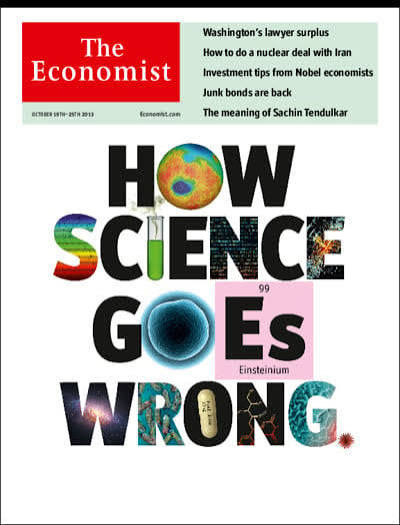{width=78% fig-align="center"}
:::
::: {.column width="62%"}

::: {.fragment}
**Reproducible** means: someone else can regenerate every table and figure from the raw data and the code, without asking the authors

Before we ask whether a result is *right*, we ask whether it can be *recomputed*
:::

::: {.fragment}
**This lecture.** We look at what breaks reproducibility in practice, run a small research experiment, and build a factor from a portfolio sort step by step

**Afterwards** you can check a report for reproducibility, explain why a reproducible result still carries researchers' degrees of freedom, and name the choices inside a portfolio sort
:::

:::
::::

## Reproducibility in top finance journals

{width=60% fig-align="center"}

- **Code**: required for empirical work, simulations, numerical computations and experimental studies
- **Data**: if actual data cannot be shared, authors must provide pseudo-data

## What makes reproducibility hard?

:::::{.columns}

::: {.column width="64%"}

[Your turn]{.your-turn-badge} **What can go wrong?**

- What problems can occur when running your own project?
- Do you believe your own reports are reproducible?

::: {.fragment fragment-index=1}
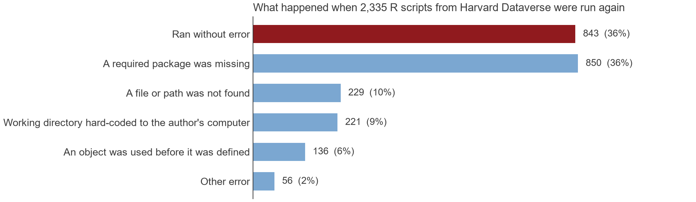{width=100%}
:::

:::
::: {.column width="36%"}

::: {.fragment fragment-index=1}
**Minimum requirements**

1. Raw data and code that regenerate every table and figure
1. Software and package versions, random seeds
1. Materials openly available, not "upon request"
1. Code that a stranger (= future you) can read
:::

:::
::::

## Evidence from this course

:::: {.r-stack}
::: {.fragment .fade-out fragment-index=1}
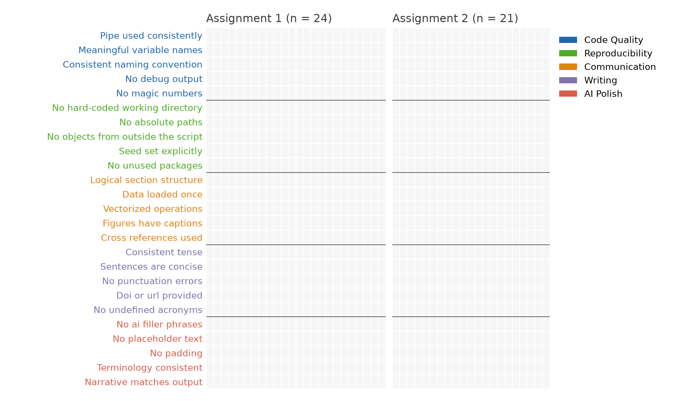{width=72% fig-align="center"}
:::
::: {.fragment .fade-in fragment-index=1}
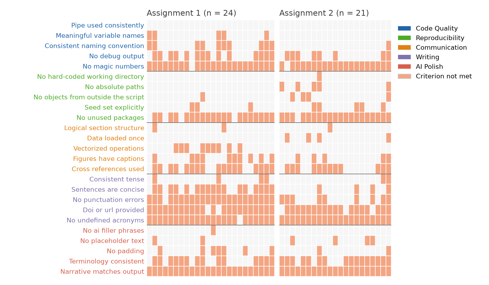{width=72% fig-align="center"}
:::
::::

- Same checks on this course's two assignments, five representative criteria per group. Unused packages and absolute paths remain the weak spots

# Non-standard errors

## Suppose reproducibility is solved. Are we done?

:::::{.columns}

::: {.column width="37%"}

::: {.chat theme="imessage" names="You,Albert"}
::: {.speaker-2}
Hello everybody 👋 We are starting a large project on market efficiency. Would you join as one of the research teams?
:::

::: {.fragment .speaker-1}
Sure, sounds fun. What do you need from us?
:::

::: {.fragment .speaker-2}
::: {.attachment}
📄 **hf-trading-data.parquet**
:::
:::

::: {.fragment .speaker-2}
Hypothesis 1: market efficiency improves over time. Please send me your t-statistic.
:::

[👍 164]{.fragment .reaction}
:::

:::
::: {.column width="63%"}

::: {.fragment}
::: {.your-turn}

[Your turn]{.your-turn-badge}

**1. Data.** Daily trading volume of the Dow Jones 30 constituents, 1995 to 2025

::: {.small-code}
::: {.panel-tabset}
### R
```{.r}
library(tidyfinance)

dj30 <- download_data(
  domain = "Index Constituents",
  index = "Dow Jones Industrial Average"
)

volume <- download_data(
  domain = "Stock Prices",
  symbols = dj30$symbol,
  start_date = "1995-01-01",
  end_date = "2025-12-31"
)
```
### Python
```{.python}
import tidyfinance as tf

dj30 = tf.download_data(
    domain="Index Constituents",
    index="Dow Jones Industrial Average",
)

volume = tf.download_data(
    domain="Stock Prices",
    symbols=dj30["symbol"].to_list(),
    start_date="1995-01-01",
    end_date="2025-12-31",
)
```
:::
:::

**2. Hypothesis.** Trading volume increased over the last 30 years

**3. Send me your t-statistic.** One number per person

:::

::: {.cloud-stage}

::: {.fragment .fade-up .cloud .c1}
Shares or dollars?
:::
::: {.fragment .fade-up .cloud .c2}
Per stock or in total?
:::
::: {.fragment .fade-up .cloud .c3}
Levels or logs?
:::
::: {.fragment .fade-up .cloud .c4}
Daily, monthly, or yearly?
:::
::: {.fragment .fade-up .cloud .c5}
Trend regression or endpoints?
:::
::: {.fragment .fade-up .cloud .c6}
Which standard errors?
:::

:::

:::

:::
::::

## Non-standard errors

:::: {.r-stack}
::: {.fragment .fade-out fragment-index=1}
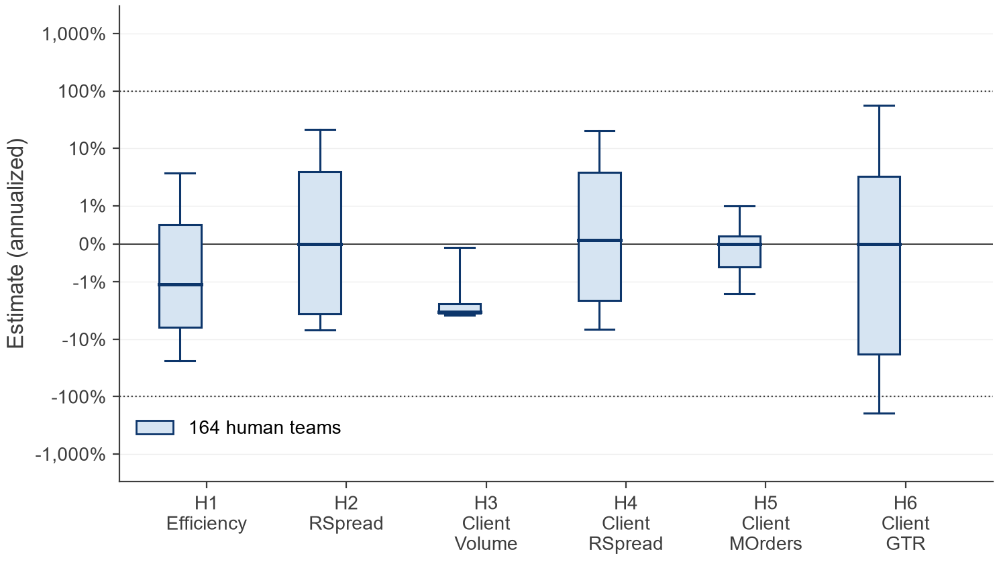{width=56% fig-align="center"}
:::
::: {.fragment .fade-in fragment-index=1}
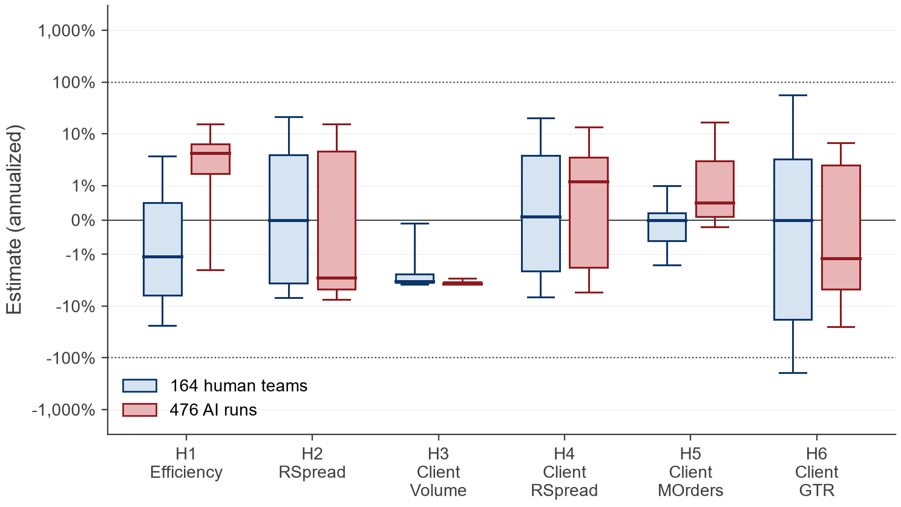{width=56% fig-align="center"}
:::
::::

- **164 human teams, same data, same six hypotheses.** Annualized estimates: box is the interquartile range and median, whiskers the 10th to 90th percentile. The dispersion co-varies only weakly with team merits, reproducibility, or peer rating, and participants heavily underestimate it (Menkveld et al., 2024)
- **476 AI runs on the same task** concentrate on a narrow set of analysis paths: less dispersion, but systematically shifted estimates for the complex hypotheses. The choices do not disappear, they move (Huang, Menkveld, and Yu, 2026)

# Construction choices in asset pricing

## The replication crisis of finance

:::::{.columns}

::: {.column width="50%"}
{width=100%}
:::
::: {.column width="50%"}

::: {.fragment}
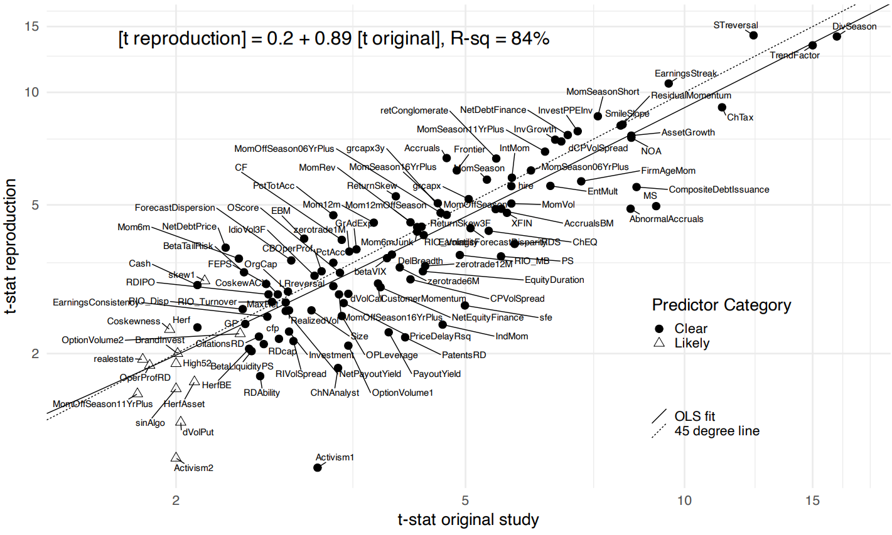{width=100%}
:::

:::
::::

## Where do factors come from?

- A stochastic discount factor (SDF) $m$ prices every excess return $r_i$: $E(m\,r_i) = 0$. Since $E(m\,r_i) = E(m)E(r_i) + \operatorname{Cov}(m, r_i)$,
$$E(r_i) = -\frac{\operatorname{Cov}(m, r_i)}{E(m)} = \underbrace{\frac{\operatorname{Cov}(r_i, -m)}{\operatorname{Var}(m)}}_{\beta_i}\;\underbrace{\frac{\operatorname{Var}(m)}{E(m)}}_{\lambda}$$
- $\beta_i$: the exposure of asset $i$ to bad times, the states in which $m$ is high. $\lambda > 0$: the price of risk, the same for every asset

::: {.fragment}
- We do not observe betas. A characteristic $z_i$ (book-to-market, past returns, size) is useful when it tells us something about the beta
$$E(r_i) = \beta(z_i)\,\lambda$$
- Value firms are often close to distress and lose most in bad states: high beta, high premium
:::

## The factor zoo

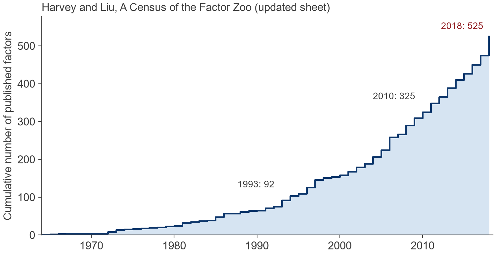{width=72% fig-align="center"}

- Any characteristic that predicts returns can be turned into a factor. Hence the zoo
- Cochrane (2011): "Now we have a zoo of new factors"
- Do we really believe in 500+ risk factors? See [this sheet](https://docs.google.com/spreadsheets/d/1mws1bU56ZAc8aK7Dvz696LknM0Vp4Rojc3n61q2-keY/edit?gid=0#gid=0) for the census

## What a portfolio sort does

:::::{.columns}

::: {.column width="34%"}

- Write $E(r_i) = g(z_i) + u_i$, with $g$ the average expected return of stocks with characteristic $z$
- A **portfolio sort** estimates $g$ without assuming its shape: group stocks with similar $z$ and average their returns
- A **factor** is the top portfolio minus the bottom portfolio

::: {.fragment fragment-index=5}
**Every step is a choice**: which stocks enter, how many portfolios, how stocks are weighted, how old the characteristic may be
:::

:::
::: {.column width="66%"}

:::: {.r-stack}
::: {.fragment .fade-out fragment-index=1}
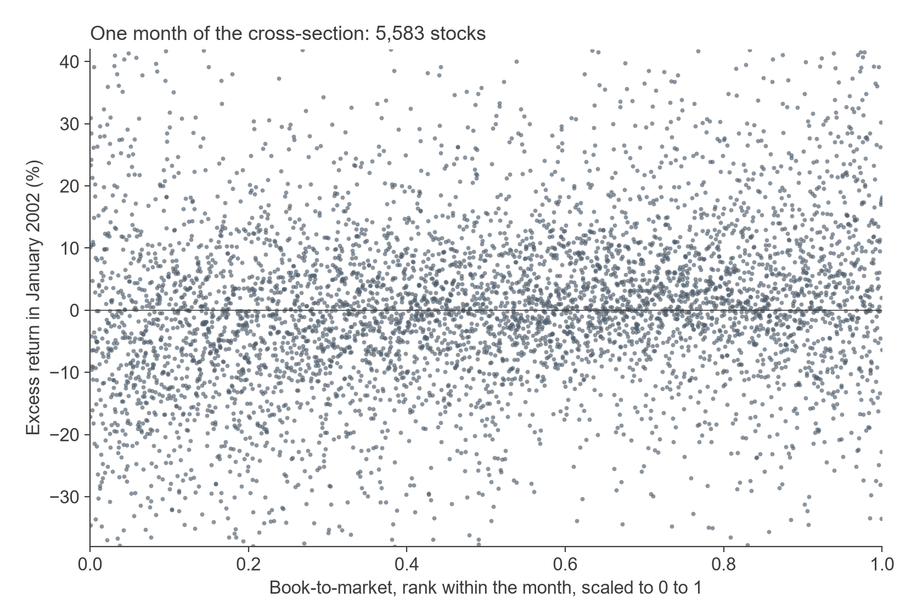{width=100%}
:::
::: {.fragment .fade-in-then-out fragment-index=1}
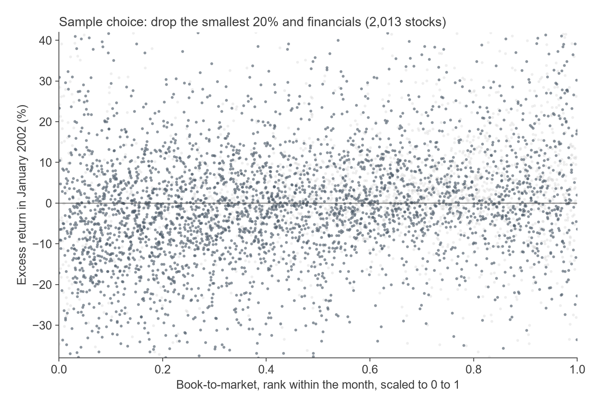{width=100%}
:::
::: {.fragment .fade-in-then-out fragment-index=2}
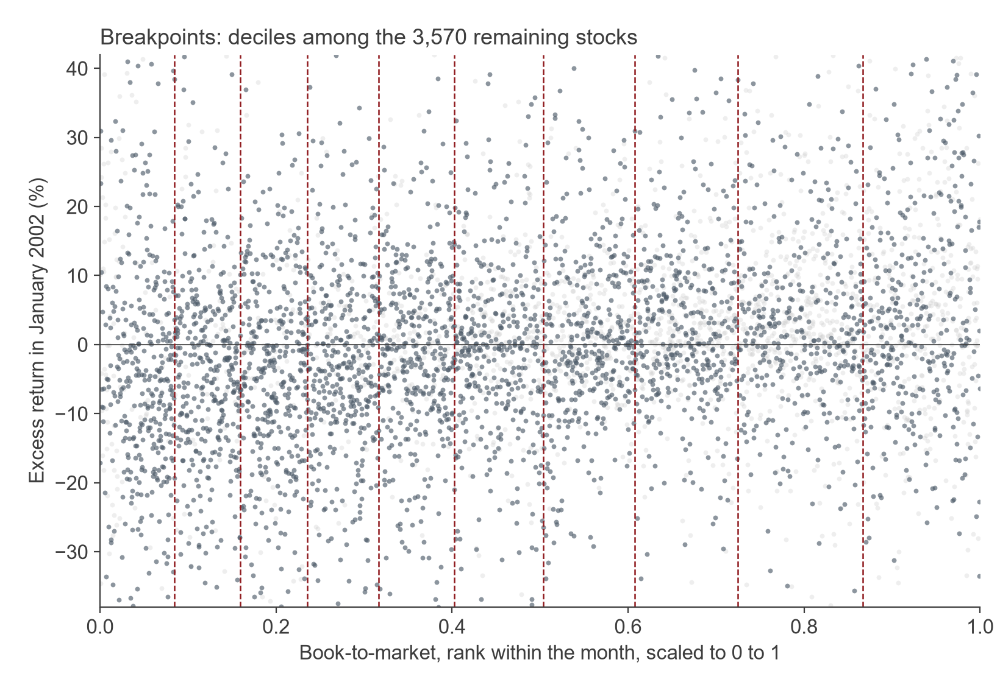{width=100%}
:::
::: {.fragment .fade-in-then-out fragment-index=3}
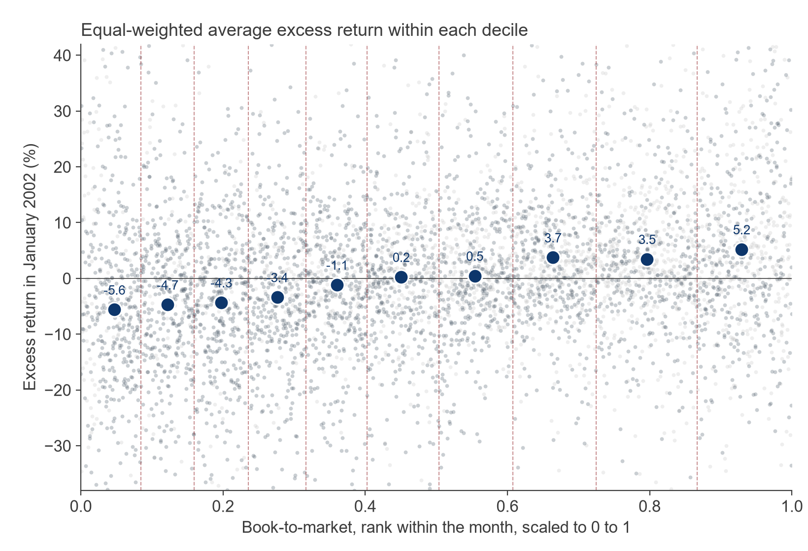{width=100%}
:::
::: {.fragment .fade-in-then-out fragment-index=4}
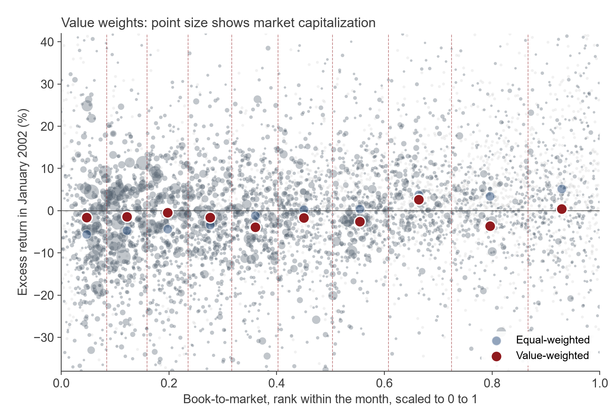{width=100%}
:::
::: {.fragment .fade-in fragment-index=5}
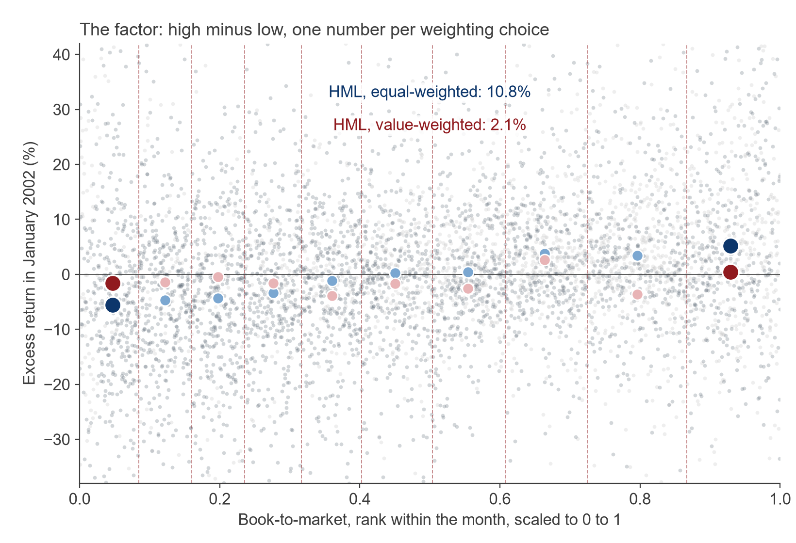{width=100%}
:::
::::

:::
::::

::: {.notes}
Book-to-market, January 2002, CRSP and Compustat via the course data. Step 1: the cross-section. Step 2: sample choice, the smallest 20 percent and financials drop out. Step 3: decile breakpoints among the remaining stocks. Step 4: equal-weighted averages within each decile estimate g(z). Step 5: weighting by market capitalization changes the averages. Step 6: HML is the high portfolio minus the low portfolio, under both weighting schemes. Repeat every month and average to get the factor premium.
:::

## Construction choices move alphas

:::::{.columns}

::: {.column width="52%"}
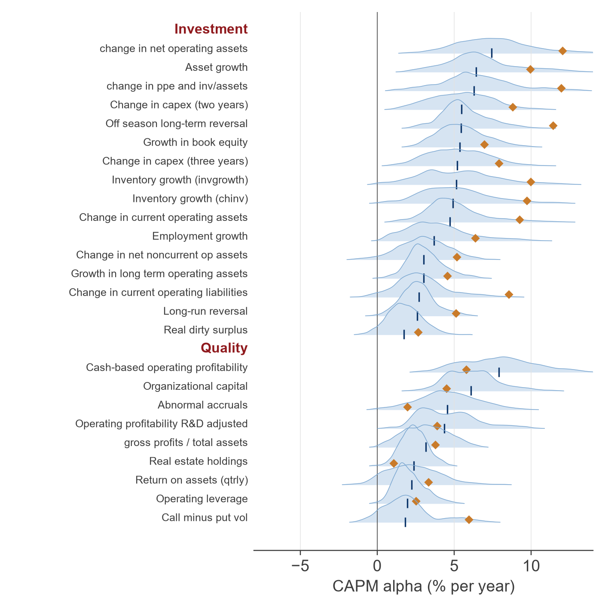{width=100% fig-align="center"}
:::
::: {.column width="48%"}

- 176 concepts from the Open Source Asset Pricing library, each constructed along 23,040 paths (Voigt and Scheuch, 2026). Two of 13 themes shown
- Within one concept, the alphas of different paths spread over several percent per year, about as wide as the typical alpha itself. The published path is often far from the median

:::
::::

## Data preprocessing choices matter

:::::{.columns}

::: {.column width="42%"}

- Take the market and 50 published factors. Keep the idea of each factor fixed, but build it with one of 3,840 defensible sorting choices
- Draw one choice per factor, compute the out-of-sample Sharpe ratio of the best portfolio, repeat a million times

::: {.fragment}
- Same ideas, Sharpe ratios between 0.5 and 1.4. The published constructions sit at the top: only about 5% of draws do better
:::

:::
::: {.column width="58%"}
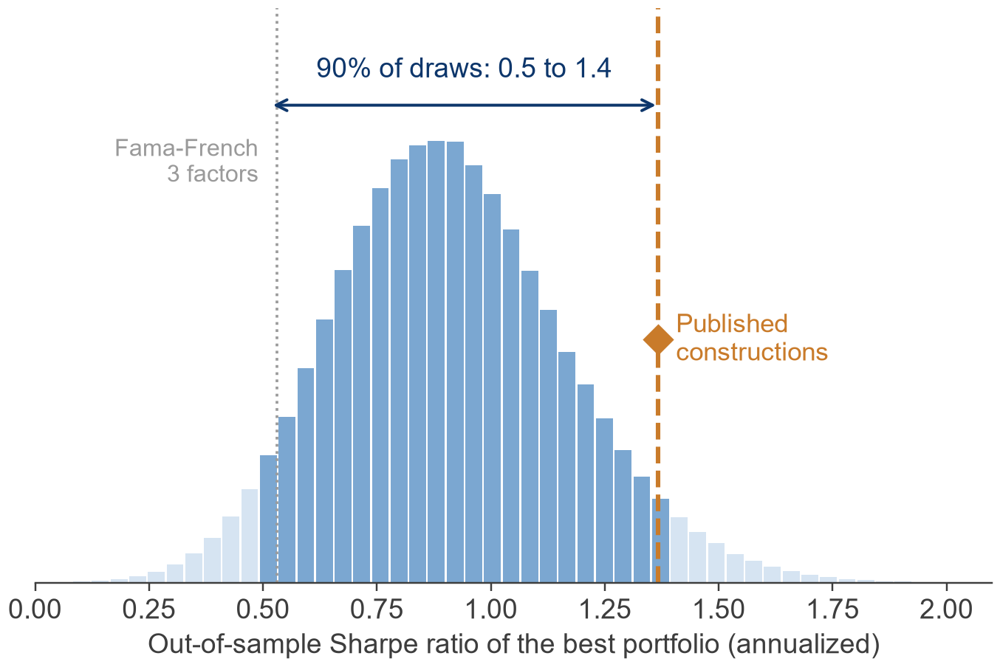{width=100%}
:::
::::

## Teaching and research

| In this lecture | In the course | In my research |
|---|---|---|
| Reproducibility and researchers' degrees of freedom | Every assignment is a Quarto report that regenerates from raw data and code; students make and defend their own modelling decisions | Non-standard errors (Menkveld et al., 2024) |
| Construction choices in a portfolio sort | Portfolio sorts and backtests on the same CRSP and Compustat data | Which construction choices move factor premia, and by how much (Voigt and Scheuch, 2026) |
| From one factor to the whole model | Factor models and portfolio choice under estimation error | Pricing the cross-section when the construction of every factor is uncertain (Gruber, Kastner, Voigt, and Weiss, 2026) |

: {tbl-colwidths="[24,40,36]"}
